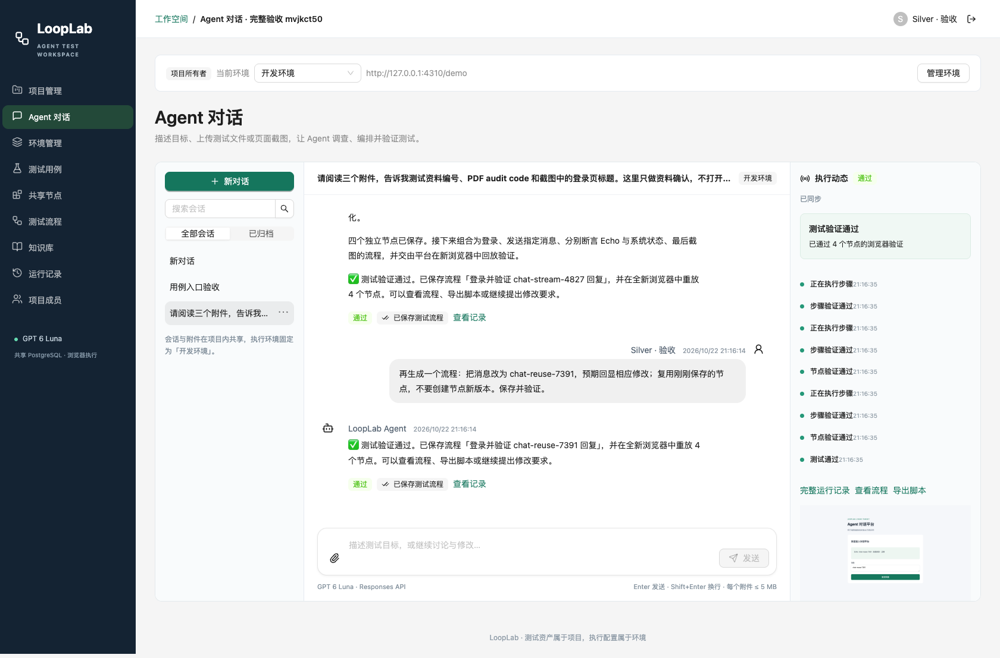

# LoopLab · Agent Test Platform

一个本地运行、通过浏览器使用的团队端到端测试平台。通过统一聊天界面输入自然语言目标、测试用例或附件，由默认的 GPT 6 Luna 探索真实页面，生成可复用节点和固定版本流程，再用 Playwright 独立回放验证。

应用代码全部使用 **TypeScript + Node.js**。用户、项目、知识库、节点版本、执行记录和截图共同保存在 **PostgreSQL**。Agent loop 从 pi 的核心源码移植到本项目维护，**不依赖任何 pi npm 包**。



## 已实现

- 邮箱/密码登录；项目目录、创建、编辑、归档与恢复；owner/editor/viewer 项目权限。
- 独立 Agent 对话页：多轮讨论、文件/图片/PDF 输入、Responses 流式回复、实时执行动态、会话归档与团队共享。
- Ant Design X 聊天组件与 Ant Design 管理界面、TanStack Query 缓存、React Router 深链接；列表按需分页与搜索。
- 项目独立知识库，文本与 Markdown 导入、编辑。
- 独立环境管理页；地址、变量与凭据键值表单；环境复制、归档和恢复；复制时同步复制节点版本和流程。
- 自然语言用例 → 真实浏览器探索 → 生成参数化节点 → 组合流程 → 全新浏览器回放。
- 按项目共享节点；环境独立版本；流程固定引用版本；相同 spec 复用已有版本。
- 无需模型的确定性流程回放；导出独立 TypeScript/Playwright 脚本。
- 流程分类与测试组：将健康检查、全量检查、功能检查、回归检查和一次性检查组合为环境内可复用的有序测试组。
- 整组顺序执行；单项失败后继续执行其余流程，并汇总结果、保留各项执行记录和截图。
- 指定节点的 Agent 修复，保留断言要求与其他节点引用，创建新版本后验证。
- PostgreSQL 任务队列、取消、心跳、进程异常后的失败标记。
- 执行时间线、失败截图、共享图片附件、JSON 报告和版本快照。
- 默认 `gpt-6-luna`，使用 OpenAI Responses API，支持流式响应、函数调用和 reasoning item 回传。

聊天功能与验收见 [Agent 对话入口](docs/agent-chat.md)。管理选型、性能测量和边界见 [管理 UI 审阅](docs/ui-review.md)。

可以将独立运行的 LoopLab 实例作为被测项目，由平台自身生成和重放测试。配置与验证方法见 [自举测试](docs/self-testing.md)。

## 本地启动

需要 Node.js **22+**（推荐 24）、npm 和 PostgreSQL。已在 Node.js 24.19、PostgreSQL 18.6、Google Chrome 上完成验收。

```bash
npm ci
cp .env.example .env.local
```

编辑 `.env.local`。AI 调用有三个独立配置：

| 配置              | 用途                                                                                       |
| ----------------- | ------------------------------------------------------------------------------------------ |
| `OPENAI_BASE_URL` | Responses API 基础地址；留空时使用外部配置文件中的地址，或默认 `https://api.openai.com/v1` |
| `OPENAI_API_KEY`  | API 密钥；只在服务器使用                                                                   |
| `OPENAI_MODEL`    | Responses 请求中的模型名称，默认 `gpt-6-luna`                                              |

其他配置：

| 配置                  | 用途                                                          |
| --------------------- | ------------------------------------------------------------- |
| `DATABASE_URL`        | 专用 PostgreSQL 数据库连接地址；支持远程数据库                |
| `APP_SECRET`          | 至少 32 个随机字符；加密环境凭据；共享数据库的实例必须一致    |
| `OPENAI_ENV_FILE`     | 可选：从已有 env 文件读取未单独配置的 AI 参数                 |
| `HOST`                | 服务监听地址，默认 `127.0.0.1`                                |
| `PORT`                | 服务监听端口，默认 `4310`                                     |
| `PLAYWRIGHT_CHANNEL`  | 使用本机 Chrome 时设为 `chrome`；留空使用 Playwright Chromium |
| `RUN_TIMEOUT_MS`      | 单次运行的总超时，默认 `600000` 毫秒                          |
| `DEMO_TARGET_ENABLED` | 是否启用验收用的 `/demo` 对话平台，默认 false                 |
| `COOKIE_SECURE`       | HTTPS 部署设为 true                                           |

AI 三项参数分别按非空的进程环境变量 > `.env.local` > `OPENAI_ENV_FILE` 读取；没有设置时，Base URL 和模型使用上述默认值。模板中 `OPENAI_BASE_URL` 留空，因此使用外部凭据文件时不会遮盖其中的地址。应用只实现 Responses API 接入；模型默认使用 `gpt-6-luna`，其他模型或网关别名需要支持本项目使用的 Responses 功能。

如果已有本地 Docker PostgreSQL，可以先运行以下命令自动创建专用角色、数据库和 `.env.local`（已有配置时拒绝覆盖）：

```bash
npm run setup:local -- <postgres-container-name>
```

然后配置 OpenAI 凭据。如果使用 Playwright 自带浏览器：

```bash
npx playwright install chromium
```

启动：

```bash
npm run build
npm start
```

访问 **http://127.0.0.1:4310**，注册账户。启动时自动迁移专用数据库中的 `qa` schema，不修改其他数据库；也可以单独运行 `npm run migrate`。

开发时分别启动：

```bash
npm run dev
npm run dev:web
```

前端开发地址是 `http://127.0.0.1:4311`，API 代理到 4310。Node.js 服务持续执行任务，关闭浏览器页面不会取消任务。

## 团队共享

推荐团队共用一个 Node.js 服务地址和 PostgreSQL 数据库。其他成员先注册账户，由项目所有者在“项目成员”中按邮箱添加。成员看到的是相同的知识、节点、流程、截图和报告。

也支持多个 Node.js 实例连接同一远程 PostgreSQL：使用相同的 `DATABASE_URL` 和 `APP_SECRET`，并确保所有执行器都能访问被测环境 URL。共享队列通过数据库行锁领取任务，避免两个执行器领取同一个任务。多台机器不要把各自含义不同的 `localhost` 当作同一个被测环境。

远程服务可设置 `HOST=0.0.0.0`，由反向代理提供 HTTPS，并设置 `COOKIE_SECURE=true`。数据库角色需要在专用数据库中创建和维护 `qa` schema 的权限。

## 使用流程

1. 创建项目，在知识库描述产品操作路径与验证标准。
2. 创建环境，填写真实目标 URL、变量、登录凭据。
3. 打开“Agent 对话”描述目标，也可上传测试文件、PDF、截图，或先讨论需求。
4. 已有用例点击“与 Agent 生成”进入同一聊天页面。Agent 调查页面并查询共享节点，缺少的能力才新建。
5. 在运行详情查看实际步骤、断言和截图。通过由独立回放结果决定。
6. 后续使用“直接回放”，无需再次调用模型或生成节点。
7. 页面更新造成节点失效时，在节点库选择“Agent 修复”，进入聊天补充要求。修复仅影响当前环境的新版本。
8. 通过“复制环境”复用资产，再单独调整新环境配置与节点实现。
9. 在“测试组”中按当前环境选择流程并调整顺序；运行后查看整组结果，再进入单项报告检查失败原因。

健康检查适合验证服务和关键入口是否可用，功能检查针对具体能力，回归检查用于功能变更后的整体验收，一次性检查用于临时调查。全量检查通常是覆盖多个类别的测试组：同一流程可以加入多个组，无需重复生成。组内流程各自使用新的浏览器，顺序只保证先后执行，不共享浏览器登录状态。

节点可使用 `navigate`、`reload`、`fill`、`click`、`press`、`waitFor`、`assertText`、`assertVisible`、`extractText` 和 `screenshot`。等待和断言可配置 1–180 秒的超时。变量支持：

- `{{baseUrl}}`：环境地址。
- `{{param.message}}`：节点输入参数。
- `{{secret.password}}`：加密环境凭据，运行时解析。
- `{{var.tenant}}`：环境普通变量。
- `{{output.session}}`：前面节点提取的文本结果。

导出的 `.ts` 流程在 ESM 项目中运行，安装 `playwright` 和 `tsx`，设置 `TEST_BASE_URL`、`TEST_SECRET_<key>`、`TEST_VAR_<key>`；也可设置 `PLAYWRIGHT_CHANNEL=chrome`。脚本不包含环境凭据，也不依赖 LoopLab 或 pi。

## 验证

```bash
npm run build              # 后端、前端严格 TS 检查与生产构建
npm run verify:self         # 独立 LoopLab 实例的真实自举测试
npm run verify:self-chat    # 在自举项目中验证真实 AI 对话、上下文与刷新
npx tsx scripts/verify-self-suites.ts        # 测试组管理、顺序与汇总
npx tsx scripts/verify-self-suites-cancel.ts # 整组取消与未执行项目
npm run verify:self-chat -- --replay # 复用聊天测试流程，目标仍调用真实模型
npm run verify:self -- --replay # 复用已生成的自举流程
```

本项目后续通过平台的端到端流程验证，不新增单元测试。自举环境和账户准备方式见 [自举测试](docs/self-testing.md)。

本地已验证：真实模型生成 4 个节点、第二位用户无模型回放、环境复制后独立回放、故意破坏选择器得到失败证据、Agent 局部修复后通过、桌面/移动端基础交互、导出脚本独立执行，以及两个服务实例共享数据库领取任务。详见 [验收记录](docs/acceptance.md)。

GitHub Actions 构建配置保留在 `docs/ci-workflow.template.yml`。该模板只执行构建；平台端到端验收需要另行提供两个实例、数据库和模型凭据。

## 代码结构

```text
src/runtime/        从 pi 移植并维护的 Agent loop、工具管线、消息队列
src/openai/         Responses 流适配，默认 GPT 6 Luna
src/testing/        节点 schema、Playwright 执行器、TS 导出
src/server/         API、身份与权限、数据库迁移、共享任务执行器
web/                React 管理工作台与演示目标
scripts/            初始化、迁移、真实模型和端到端验收
test/              离线行为测试
```

第一版支持顺序流程与单 origin 的常规网页操作。验证码/MFA/跨域 SSO、视觉坐标操作、任意代码节点、分支循环、向量检索和浏览器进程恢复尚未实现。节点更新不会自动改写旧流程；需要重新编排、编辑流程副本或通过修复任务生成新流程。

完整实现边界与数据设计见 [架构说明](docs/architecture.md)。pi 基准提交、移植映射与本地差异见 [第三方声明](THIRD_PARTY_NOTICES.md)；原 MIT 许可保存在 [licenses/pi-MIT.txt](licenses/pi-MIT.txt)。

Responses 适配参考 [GPT 6 Luna](https://developers.openai.com/api/docs/models/gpt-6-luna)、[函数调用](https://developers.openai.com/api/docs/guides/function-calling) 和 [流式响应](https://developers.openai.com/api/docs/guides/streaming-responses) 官方文档。

构建会预生成 Brotli/gzip 静态资源；哈希资产长期缓存，HTML 重新验证。
