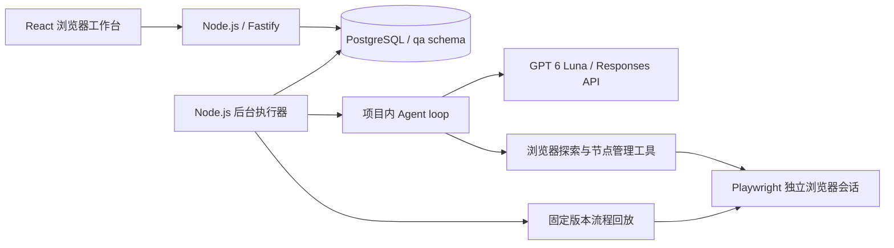

# 第一版设计与需求对应

## 用户与共享数据

用户通过邮箱/密码注册登录，密码使用带随机盐的 scrypt，浏览器保存 HttpOnly 会话 cookie。数据库只保存 session token 摘要。项目成员分为 owner、editor、viewer；所有业务接口先检查成员身份，编辑接口进一步检查权限。

节点属于项目，不属于创建它的用户。`nodes(project_id,key)` 唯一；`node_versions(node_id,environment_id,version)` 唯一。版本内容不可覆盖。相同环境内再次保存相同 spec，会复用最后一版。数据库事务和 advisory lock 串行分配版本号，避免多人同时写入时覆盖版本。

第一版的注册面向自托管团队，没有邮件验证或密码找回。公网部署应配置 HTTPS、反向代理和团队访问范围；本机默认仅监听 127.0.0.1。

## 需求到实现

| 需求                     | 实现                                                                                           |
| ------------------------ | ---------------------------------------------------------------------------------------------- |
| 登录、创建项目、多人协作 | 用户、session、项目成员和服务端权限检查                                                        |
| 项目独立知识库           | 文本/Markdown 知识条目，支持文件文本导入；只注入当前项目知识                                   |
| 多部署环境               | 独立 URL、变量、加密凭据和节点实现版本                                                         |
| 输入自然语言测试用例     | 用例标题和目标/预期结果；GPT 6 Luna 解读                                                       |
| Agent 登录真实网站并探索 | Playwright 独立 BrowserContext；DOM/可访问性树与真实页面操作工具                               |
| 生成可重复执行脚本       | Agent 产出经过 schema 校验的节点 spec，固定版本组成流程；可导出独立 TypeScript/Playwright 脚本 |
| 节点复用                 | 优先查询节点库；节点参数化；回放时无需模型                                                     |
| 节点修复                 | 指定节点，Agent 调查并创建新版本，保留断言预期；原流程顺序、输入和其他节点版本不变             |
| 环境复制                 | 在事务内复制所有节点版本和流程，重映射 revision ID；凭据复制由用户显式选择                     |
| 执行与报告               | 共享队列、步骤状态、失败原因、截图、JSON 报告和版本快照                                        |
| pi 核心复用              | 从固定提交移植到 `src/runtime`；无 pi npm 依赖                                                 |
| 单模型单协议             | 固定 `gpt-6-luna`，仅 OpenAI Responses；使用官方 SDK 处理 HTTP/SSE，不使用 SDK 的 Agent loop   |

## 运行结构

Web 服务与后台执行器当前在同一 Node 进程内，浏览器由 Playwright 启动为独立进程；每个实例一次处理一个任务。长任务不依赖请求连接或前端页面生命周期。任务存入 PostgreSQL，通过 `FOR UPDATE SKIP LOCKED` 领取，多个服务实例可以连接同一库处理队列。每个执行器定期续租；超过 60 秒没有心跳的任务标记为失败，不自动重放可能产生副作用的步骤。

环境凭据用 APP_SECRET 派生的密钥进行 AES-256-GCM 加密。实例共享数据库时必须使用相同 APP_SECRET，否则无法解密共享环境。凭据字段只向 Agent 提供 key 名称；浏览器执行器解析 `{{secret.key}}`，日志中的已知凭据值被替换。截图作为受项目权限保护的 bytea 附件保存到数据库，成员不需要访问创建者的本地磁盘。

## 生成、执行和修复

生成任务先让 Agent 在真实浏览器中探索，调用 `list_nodes`、`save_node`、`finish_flow`。完成后关闭探索浏览器，在全新上下文中回放所保存流程。至少有一项断言，且全部步骤实际通过，才标记 passed。

普通执行从共享数据库加载固定 revision ID。Agent 不参与，因此不会每次重新生成组件。每次运行保存环境地址、用例、知识和具体版本内容快照，用于审计。

修复只能更新选中的逻辑节点。不能删除旧的 assertText 预期或 assertVisible 断言，也不能改变原流程的其他节点引用、顺序和参数。旧版本和旧运行保留。修复失败会按实际失败报告，不修改测试目标来制造通过。

## 当前边界

- 流程为顺序组合，支持输入参数与 extractText 输出；尚无循环、条件分支和子流程编辑器。
- 节点是受约束的浏览器操作 spec，而不是任意服务器代码。导出的 TS 脚本可独立运行。自定义 shell/任意 JS 节点不开放给 Agent。
- 页面探索基于 DOM 和可访问性树；截图作为执行证据。没有图像坐标点击、验证码、MFA 或跨域 SSO 流程支持；顶层/框架导航限制在环境 origin。
- 知识库使用项目文本上下文，没有向量检索、PDF/Office 解析或自动知识维护。
- 任务重启后标记失败并等待显式重跑，不恢复浏览器内存或自动重放未知副作用。
- 每个实例的浏览器可访问被测环境；多个本地服务连接同一数据库时，环境地址必须对所有执行器有一致含义。建议团队共用一个服务地址和数据库。
- 大规模录像/截图应后续迁移到共享对象存储；第一版使用 PostgreSQL 以保证跨机器可访问。
- 所有数据库变更由启动迁移管理。新增版本需要新增 migration，不能修改已应用的 v1 SQL。
