# LoopLab 项目架构与运行手册

本文是 LoopLab 的项目规范，覆盖目标、代码结构、接口与数据契约、运行方式和验收流程。外部 Agent 与内网 Agent 通过同一份手册[接力开发](#handoff)。实现或配置变更按[文档维护规则](#maintenance)更新本文。

| 阅读任务                 | 章节                                                                                              |
| ------------------------ | ------------------------------------------------------------------------------------------------- |
| 了解产品和模块           | [项目初衷](#scope) · [总体架构](#topology)                                                        |
| 查界面、权限、资产和表   | [平台与项目资产](#platform) · [存储与数据模型](#data)                                             |
| 查对话、模型、知识和记忆 | [对话与 Agent](#chat) · [模型与运行时](#runtime) · [项目知识与个人记忆](#memory)                  |
| 编排和执行测试           | [测试流程与浏览器](#browser) · [测试组](#suites) · [Jira 集成](#jira)                             |
| 运行、部署和验收         | [任务执行与调度](#worker) · [配置与部署](#operations) · [端到端验收](#verification)               |
| 外部与内网 Agent 接力    | [交接范围与代码边界](#handoff) · [工作台身份接入](#handoff-auth) · [Jira 站点接入](#handoff-jira) |
| 修改设计与代码           | [设计取舍](#tradeoffs) · [文档维护规则](#maintenance)                                             |

<a name="scope"></a>

## 1. 项目初衷

LoopLab 把目标网站上的验证过程变成团队可重放的浏览器测试。用户可以在聊天中描述目标、选择已有用例、上传测试材料，或从 Jira 读取需求。Agent 借助项目知识和当前账号的偏好理解目标，调查真实页面，把可复用操作写成节点，再按固定版本编排流程。执行器在独立浏览器里运行这些节点，以页面断言、截图和执行记录给出结果。

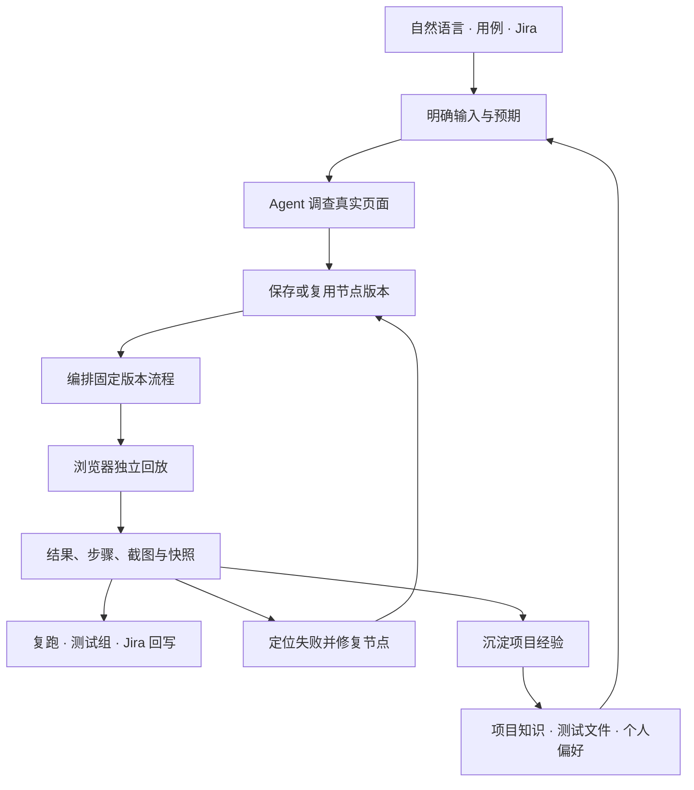

| 使用场景               | 产品入口                        | 可复用的结果                                          |
| ---------------------- | ------------------------------- | ----------------------------------------------------- |
| 测试一个新需求         | Agent 对话或测试用例            | 用例、带参数的节点和固定版本流程                      |
| 在多个环境验证同一目标 | 环境管理、环境复制、测试流程    | 共用用例和逻辑节点，在各环境固定实现版本              |
| 对关键路径做重复检查   | 直接回放、测试组                | 独立运行、组结果和可定位到步骤的证据                  |
| 目标页面变更导致失败   | 运行报告、共享节点的 Agent 修复 | 修复节点的新版本、新流程与复验结果                    |
| 基于 Jira 协作验收     | Jira 需求、Agent 对话           | Ticket 快照、用例版本、实际运行及页面核验后的回写记录 |
| 跨任务保留经验         | 项目知识库、个人记忆            | 项目共享的事实与方法、账号跨项目的测试习惯            |

| 概念       | 含义                                                                         |
| ---------- | ---------------------------------------------------------------------------- |
| 项目       | 成员权限、共享资产和测试记录的边界                                           |
| 环境       | 同一项目的一个部署目标，含地址、变量、凭据和环境级节点版本                   |
| 用例       | 测试目标、步骤与预期的文本说明，可保存历史版本                               |
| 节点       | 一段可参数化的浏览器操作或断言。逻辑节点跨环境共享，具体实现在环境下保存版本 |
| 流程       | 对节点版本和参数的有序引用，同时记录关联用例及可用的用例版本                 |
| 测试组     | 同一环境内按顺序编排的已保存流程                                             |
| 运行       | 一次入队或派生的执行记录。对话完成、浏览器通过和组汇总是不同层次的结果       |
| 证据       | 流程、用例与节点快照，运行事件，截图，以及由真实运行派生的 Jira 回写         |
| 知识与记忆 | 项目事实按项目共享，长期偏好按当前账号在本机跨项目复用                       |

<a name="topology"></a>

## 2. 总体架构

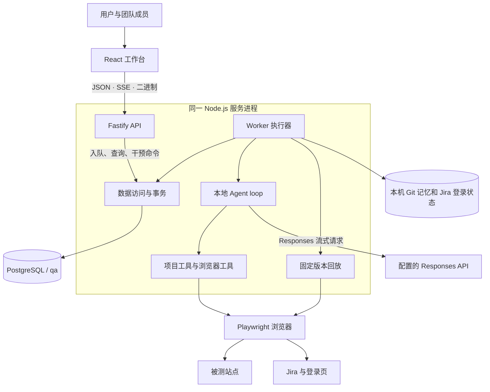

| 层             | 源码                                                                                                                                                                                                                     | 主要职责                                                 |
| -------------- | ------------------------------------------------------------------------------------------------------------------------------------------------------------------------------------------------------------------------ | -------------------------------------------------------- |
| 工作台         | [web/src/App.tsx](../web/src/App.tsx)、[web/src/admin](../web/src/admin)                                                                                                                                                 | 登录、项目路由、资源和表单、对话、状态、浏览器预览与接管 |
| 启动与 HTTP    | [src/server/main.ts](../src/server/main.ts)、[src/server/app.ts](../src/server/app.ts)、[src/server/routes.ts](../src/server/routes.ts)                                                                                  | 配置检查、数据库迁移、HTTP 生命周期、认证和公共业务路由  |
| 管理与资源     | [src/server/repository.ts](../src/server/repository.ts)、[src/server/management.ts](../src/server/management.ts)、[src/server/cases.ts](../src/server/cases.ts)、[src/server/test-files.ts](../src/server/test-files.ts) | 权限、资产管理、分页、版本分配和文件存取                 |
| 对话与执行     | [src/server/chat.ts](../src/server/chat.ts)、[src/server/chat-runtime.ts](../src/server/chat-runtime.ts)、[src/server/worker.ts](../src/server/worker.ts)                                                                | 会话与运行关联、组装上下文、执行工具、写事件和独立重放   |
| 模型和工具协议 | [src/runtime](../src/runtime)、[src/openai/responses.ts](../src/openai/responses.ts)                                                                                                                                     | Agent 循环、工具校验、流式响应解析、模型续轮             |
| 测试运行时     | [src/testing/spec.ts](../src/testing/spec.ts)、[src/testing/browser.ts](../src/testing/browser.ts)、[src/testing/export.ts](../src/testing/export.ts)                                                                    | 节点 DSL、变量解析、真实浏览器执行和独立脚本导出         |
| 观察与批次     | [src/server/preview.ts](../src/server/preview.ts)、[src/server/intervention.ts](../src/server/intervention.ts)、[src/server/suites.ts](../src/server/suites.ts)                                                          | 帧租约、人工控制、测试组快照和顺序执行                   |
| Jira           | [src/integrations/jira.ts](../src/integrations/jira.ts)、[src/server/jira.ts](../src/server/jira.ts)、[src/server/jira-tools.ts](../src/server/jira-tools.ts)                                                            | 网页适配脚本、需求快照、Agent 阶段工具和回写记录         |
| 知识与记忆     | [src/server/knowledge.ts](../src/server/knowledge.ts)、[src/server/personal-memory.ts](../src/server/personal-memory.ts)                                                                                                 | 项目 Markdown 文档、账号 Git 记忆和版本冲突检查          |
| 存储与验证     | [src/server/db.ts](../src/server/db.ts)、[scripts](../scripts)、[test](../test)                                                                                                                                          | 事务及迁移、初始化脚本、端到端验收与既有行为测试         |

普通工作台浏览器负责向服务端发送任务和观察结果。实际测试浏览器由 Worker 所在机器启动，能访问什么站点取决于该机器的网络、代理和登录条件。共享数据库提供资产和证据；具体领取规则见[任务执行与调度](#worker)。

<a name="platform"></a>

## 3. 平台与项目资产

### 3.1 Web 工作台

[入口](../web/src/main.tsx)按路径加载工作台或验收用的 Demo。工作台使用 React、Vite、React Router、Ant Design 和 TanStack Query。对话页使用 Ant Design X，管理页沿用表格工具栏、行操作、表单弹窗和详情抽屉的布局。列表组织方式参考 Ant Design Pro。通用组件来自依赖包，项目路由、权限和资产编辑逻辑由本仓库实现。依赖版本以 [package.json](../package.json) 和锁文件为准。

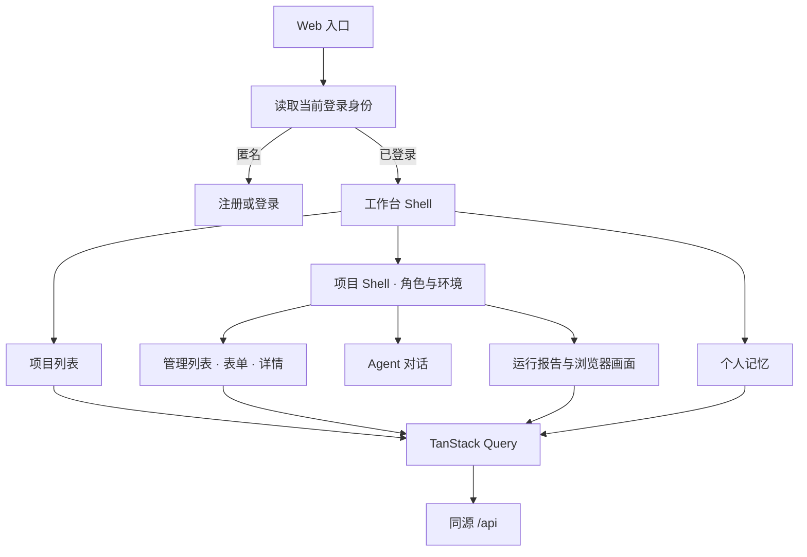

| 路径或参数                          | 页面与行为                                                                                                      | 源码                                                                                                 |
| ----------------------------------- | --------------------------------------------------------------------------------------------------------------- | ---------------------------------------------------------------------------------------------------- |
| `/projects`                         | 项目目录，按名称或描述搜索，区分进行中和归档。显示环境数、成员数和当前用户角色                                  | [Projects.tsx](../web/src/admin/Projects.tsx)                                                        |
| `/projects/:pid/:section`           | `agent`、`environments`、`cases`、`jira`、`nodes`、`flows`、`suites`、`knowledge`、`files`、`runs`、`team` 分区 | [App.tsx](../web/src/App.tsx)                                                                        |
| `env`                               | 当前环境 UUID，缺省取首个未归档环境。显式选择已归档环境仍能查看历史。切换环境时清理会话、报告和分页定位         | [App.tsx](../web/src/App.tsx)                                                                        |
| `q`、`page`、`archived`、`category` | 通用管理列表的搜索、页码、归档筛选和流程分类。测试文件库有自己的分页与筛选状态                                  | [Resources.tsx](../web/src/admin/Resources.tsx)、[FileLibrary.tsx](../web/src/admin/FileLibrary.tsx) |
| `chat`、`run`、`suiteRun`           | 定位会话、单次报告或批次报告。单次报告优先于批次报告                                                            | [App.tsx](../web/src/App.tsx)、[AgentChat.tsx](../web/src/admin/AgentChat.tsx)                       |
| `/memory`                           | 账号级个人记忆入口，工作台页眉始终可达                                                                          | [PersonalMemory.tsx](../web/src/admin/PersonalMemory.tsx)                                            |
| `/demo`                             | 独立入口的验收目标，受服务端 `DEMO_TARGET_ENABLED` 控制                                                         | [demo.tsx](../web/src/demo.tsx)、[app.ts](../src/server/app.ts)                                      |

页面懒加载，环境、用例、知识和成员等资源共享 [Resources.tsx](../web/src/admin/Resources.tsx) 与按需加载的 [ResourceEditor.tsx](../web/src/admin/ResourceEditor.tsx)。节点步骤以 JSON 编辑，流程通过表单依次选择节点版本并填写参数。浏览器按页面显示角色和归档状态控制按钮，服务端对直接 API 调用执行同样的授权检查。

| 读取路径                                      | 返回内容与刷新策略                                                                                                                                                        |
| --------------------------------------------- | ------------------------------------------------------------------------------------------------------------------------------------------------------------------------- |
| `GET /api/auth/me`                            | 当前账户及配置的模型，匿名时 `user: null`。登录、注册、退出时更新身份缓存并清理其他查询                                                                                   |
| `GET /api/manage/projects`                    | 当前账号有成员记录的项目页，附当前角色、未归档环境数与成员数                                                                                                              |
| `GET /api/projects/:pid/workspace`            | 项目、角色和轻量环境列表，进入项目时先取得这一层                                                                                                                          |
| `GET /api/projects/:pid/resources/:resource`  | 独立读取环境、用例、节点、流程、运行、知识或成员页。默认每页 20 条，上限 100 条，参数包括 `page`、`pageSize`、`q`、`archived` 和 `environmentId`。流程额外支持 `category` |
| `GET /api/projects/:pid`                      | 验收脚本使用的聚合接口，含全部项目知识、非草稿用例、成员、所选环境流程和最新节点版本，以及最近 80 条运行                                                                  |
| `GET /api/runs/:rid?incremental=true&after=…` | 报告按事件 ID 增量追加，每次最多 250 条，返回 `nextCursor`、`hasMore`、运行摘要和附件元数据。非增量调用返回运行快照，事件批次上限 10,000 条                               |

共享 [API 客户端](../web/src/admin/client.tsx)使用相对路径 `/api`，传递 AbortSignal。默认缓存新鲜期 30 秒，缓存回收时间 5 分钟，查询失败重试一次，窗口回到前台时按过期状态重新读取。编辑成功后按项目、资源或 Jira 缓存键失效。普通资源无周期刷新，运行列表的当前页存在活动任务时每 2.5 秒轮询。单次报告有未取完的事件时每 100 毫秒取下一批，活动期间每 1.5 秒读取增量，已结束且取完时停止周期请求，后台标签页停止这两类轮询。报告事件在前端累积，长历史仍占用内存。对话和预览的专用更新机制见各自小节。

构建由 Vite 输出到 `web-dist/`，[compress-web.ts](../scripts/compress-web.ts)给 JS、CSS、HTML、SVG 生成 gzip 和 Brotli。Fastify 静态服务优先使用预压缩文件，哈希资源缓存一年且标记 `immutable`，HTML 使用 `no-cache`，未匹配的 Web 路径回退到 `index.html`。API、缺失静态资源以及未启用的 Demo 路径按 404 处理。开发服务器端口 4311，将 `/api` 和 `/demo/api` 代理到 4310。参见 [app.ts](../src/server/app.ts)、[vite.config.ts](../vite.config.ts)。

### 3.2 API、身份与权限

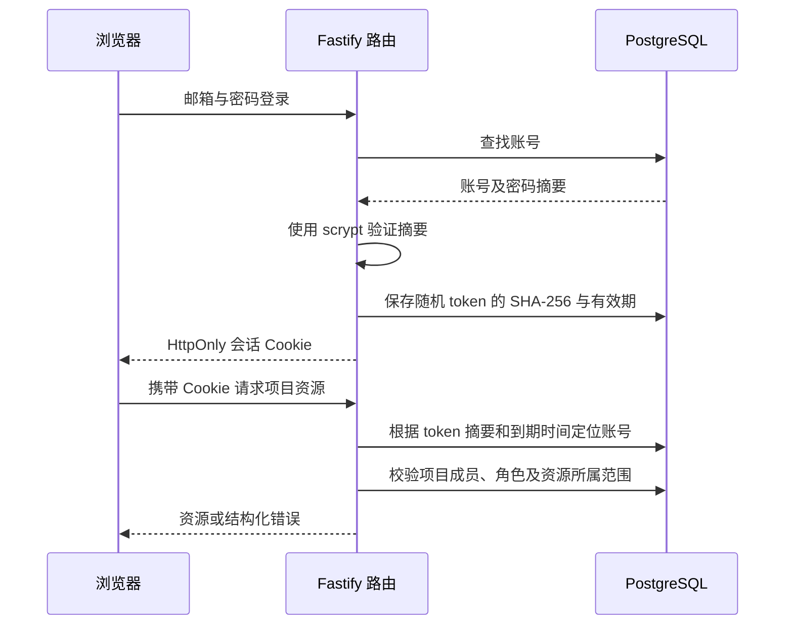

- [routes.ts](../src/server/routes.ts)统一处理 `/api/` 的身份。注册和登录将邮箱转小写。密码以随机 16 字节盐和 scrypt 派生值保存，登录用恒定时间比较摘要。登录和注册都创建 32 字节随机 token。数据库只持有 SHA-256 摘要，浏览器收到 `qa_session`，其有效期 7 天，属性为 `HttpOnly`、`SameSite=Strict`、`Path=/`，`Secure` 由 `COOKIE_SECURE` 控制。`POST /api/auth/logout` 删除该摘要并清除 Cookie。参见 [security.ts](../src/server/security.ts)。
- `/api/auth/login`、`/api/auth/register`、`/api/auth/me`、`/api/health` 可匿名调用。其余 API 需要有效会话。写请求携带 `Origin` 时校验其 host 与请求 `Host` 一致。当前账户由 `currentUser` 提供，账户记忆以该账户 ID 隔离。
- [app.ts](../src/server/app.ts)默认 JSON 请求上限 1 MiB，文件上传等路由单独设置更高上限。全局请求限流每分钟 1,500 次，注册每分钟 10 次、登录每分钟 20 次。参数通常由 Zod 校验，校验错误返回 400。未登录为 401，角色或归属不足为 403，缺失资源为 404，唯一键冲突、版本冲突或生命周期冲突为 409。未知错误返回 500 和通用提示。JSON 错误使用 `{error: string}`。
- 项目权限集中于 [requireMember](../src/server/repository.ts)，在服务端查询成员表。通过环境 ID、版本 ID、文件 ID、运行 ID 访问资源时，查询或二次校验同时约束其项目。涉及环境版本的读取与写入还校验环境归属。待执行任务开始时再次校验请求人仍可编辑项目。
- 场外阶段用本地测试账号模拟企业身份场景。当前注册、登录、退出和会话到期均由本地实现处理，管理员按已注册邮箱添加项目成员。企业身份由内网 Agent 从认证边界接入。 [工作台身份接入](#handoff-auth)

| 操作                                           | owner      | editor     | viewer     | 附加条件                                               |
| ---------------------------------------------- | ---------- | ---------- | ---------- | ------------------------------------------------------ |
| 浏览项目资产、对话、运行、报告和授权附件       | ✓          | ✓          | ✓          | 归档后仍可读                                           |
| 创建和修改项目资产、发送消息、执行、取消与接管 | ✓          | ✓          |            | 写入检查项目归档。运行与多数环境写入另外检查环境归档   |
| 修改项目名称与描述、增删成员或变更角色         | ✓          |            |            | 项目可写。只能管理 editor/viewer，不能改动或移除所有者 |
| 归档与恢复项目                                 | ✓          |            |            | 归档前拒绝任何 queued/running 任务                     |
| 归档与恢复环境                                 | ✓          | ✓          |            | 项目可写。归档前拒绝该环境的 queued/running 任务       |
| 读取或编辑个人记忆                             | 自己的账号 | 自己的账号 | 自己的账号 | 账户范围独立于项目成员角色                             |

项目创建和首位所有者成员记录在同一事务写入。项目与环境用 `archived_at` 进行可恢复归档。归档写入对项目或环境行取 `FOR UPDATE`，入队与节点、流程、测试组等关键写入按项目、环境顺序取 `FOR SHARE`，因此检查活动任务和入队可以互斥。读取接口保留归档资产与历史执行记录。环境普通更新、克隆、节点、流程、测试组与入队会要求活动环境。独立凭据 PATCH 接口检查项目编辑权与环境归属，未要求环境为活动状态。参见 [management.ts](../src/server/management.ts)、[repository.ts](../src/server/repository.ts)、[routes.ts](../src/server/routes.ts)。

### 3.3 项目、环境与资产版本

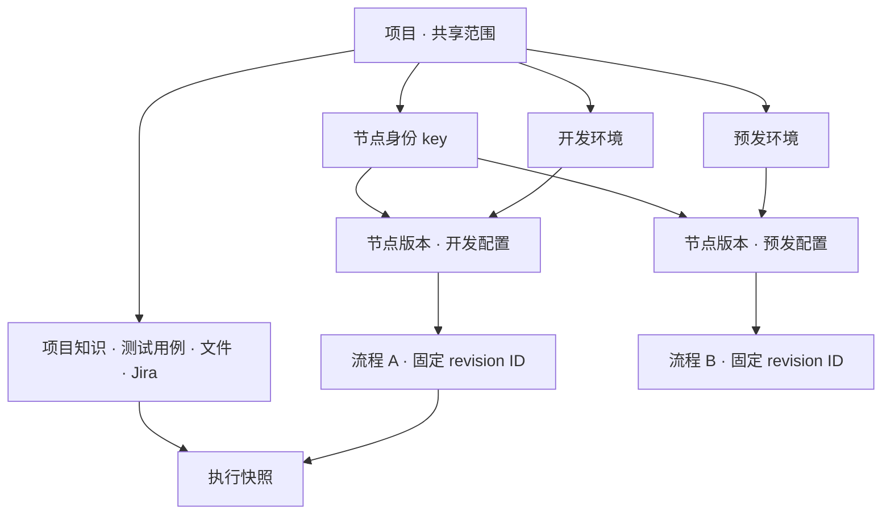

| 资产     | 所属与内容                                                                | 更新和版本语义                                                                                                                                                    |
| -------- | ------------------------------------------------------------------------- | ----------------------------------------------------------------------------------------------------------------------------------------------------------------- |
| 项目     | 成员、知识、用例、节点身份、文件、Jira 记录                               | 项目名称和说明可编辑。归档停用编辑和新运行，恢复后可继续使用                                                                                                      |
| 环境     | 同项目内名称唯一。保存 HTTP(S) 基础地址、字符串变量、加密凭据             | 地址禁止内嵌用户名和密码。变量、凭据字典各最多 50 项，值最多 10,000 字符。读接口返回 `secretKeys`                                                                 |
| 测试用例 | 项目范围的标题、说明、可选 Jira 关联                                      | `test_cases` 为当前版本，`test_case_versions` 保存历史。事务内锁定当前行，对传入的 `expectedVersion` 做冲突校验。同内容重复保存复用当前版本，变更递增版本并写快照 |
| 节点身份 | `nodes(project_id,key)` 唯一，名称和描述由最近一次保存更新                | 节点身份在项目内共享。节点版本按环境独立编号，已保存 spec 和生成的 `source` 保持稳定                                                                              |
| 节点版本 | `node_versions(node_id,environment_id,version)` 唯一，UUID 为 revision ID | 保存时校验 spec，事务用项目、key 与环境计算 advisory lock 串行分配版本。与该环境最后一版深比较相同则复用，否则追加一版                                            |
| 流程     | 项目和环境范围，绑定用例和版本，`steps` 是有序的 `{revisionId, params}`   | 保存创建新流程。解析时确认 revision 归属并检查节点声明的输入都已提供。显式传入 `expectedCaseVersion` 时校验用例未变。分类可以单独更新                             |
| 测试组   | 一个环境内的有序流程 ID 列表                                              | 定义可更新、删除。启动批次时冻结流程顺序及名称，用独立 `runs` 保存各项结果                                                                                        |
| 项目知识 | 项目内共享的标题和正文，带更新时间                                        | 通过界面或 Agent 修改正文。更新同一条目，支持删除                                                                                                                 |
| 测试文件 | 同一项目各环境共享的不可变内容，通过文件 UUID 引用                        | 修改内容需要上传新文件。现有文件只改变归档状态，旧流程及旧消息可继续引用                                                                                          |

用例标题最多 120 字符，说明最多 20,000 字符。无用例的聊天可创建草稿，普通用例列表过滤 `is_draft`，正式保存时记录草稿的原版本和新版本。用例读取可指定 `version`，历史返回原题名、说明和 Jira 关联，并另外返回当前版本号。关联 Jira 时检查 Ticket 属于当前项目。流程保存时固定当前 `case_version`，执行时按该版本加载用例。`case_version` 为空时读取当前用例。更新节点或用例会追加版本，重编排或修复会生成新流程。具体约束见[测试流程与浏览器](#browser)。 [cases.ts](../src/server/cases.ts) · [repository.ts](../src/server/repository.ts) · [worker.ts](../src/server/worker.ts)

环境凭据以 `SHA-256(app_secret)` 派生密钥，使用 AES-256-GCM、随机 12 字节 IV 与认证标签写入数据库。更新环境时可整体提供 `secrets`，界面通常提交 `secretChanges.set` 和 `secretChanges.remove`。服务端在事务中锁定凭据行，合并指定修改并重加密。项目成员只通过读接口取得键名，Agent 在流程中引用 `{{secret.key}}`，执行器运行时展开。共享数据库的实例启动时读取同一个 `app_secret`。已知凭据值会在日志或快照的对应处理入口替换成占位文本。

环境复制在一个事务内建立新环境，复制变量，要求填写新名称和基础地址。凭据复制需显式启用 `copySecrets`，缺省创建空凭据。复制先为目标环境创建节点版本并建立原 revision ID 到新 revision ID 的映射，再复制流程并替换其中的 revision ID，最后复制测试组并重映射流程 ID。节点身份、用例、知识和文件继续使用项目级记录，历史运行和会话留在原环境。

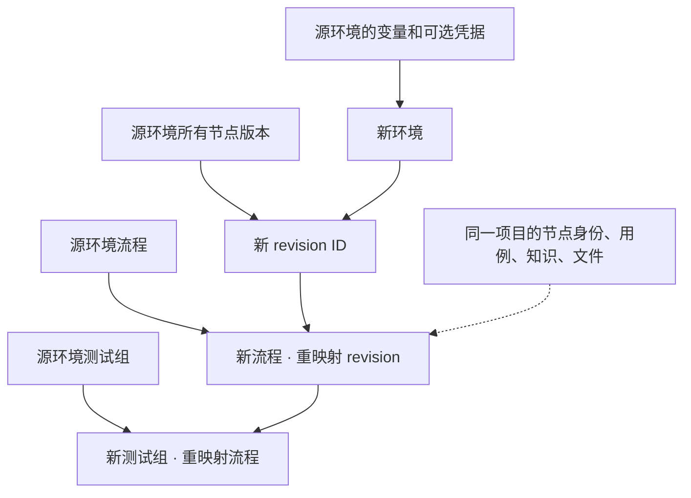

### 3.4 测试文件库与常用资源接口

测试文件库使用 JSON 上传 Base64，单文件上限 10 MiB，上传路由请求体上限 15 MiB。保存时校验 Base64 的规范编码，限制文件名和 MIME 语法，净化路径分隔符和控制字符，计算 SHA-256 并保存原始字节。哈希供核验，文件身份为 UUID，上传相同内容可得到不同文件 ID。列表只返回元数据，下载使用附件响应和 `private, no-store`，并限制浏览器内联执行。归档文件退出默认列表和 Agent 搜索，已知 ID 仍能按项目授权解析。对话附件和库文件关联的约束见 Agent 对话章节。

| 方法与路径                                                                                                                                                   | 读写意图                                               |
| ------------------------------------------------------------------------------------------------------------------------------------------------------------ | ------------------------------------------------------ |
| `POST /api/projects`、`PUT /api/projects/:pid`、`POST /api/projects/:pid/archive`                                                                            | 创建、编辑、归档或恢复项目                             |
| `POST /api/projects/:pid/members`、`DELETE /api/projects/:pid/members/:mid`                                                                                  | 用邮箱添加或变更 editor/viewer，移除指定成员           |
| `POST /api/projects/:pid/environments`、`PUT /api/projects/:pid/environments/:eid`                                                                           | 保存环境地址、变量与凭据                               |
| `POST /api/projects/:pid/environments/:eid/clone`、`POST /api/projects/:pid/environments/:eid/archive`、`PATCH /api/projects/:pid/environments/:eid/secrets` | 复制、归档或恢复、合并凭据                             |
| `POST /api/projects/:pid/cases`、`PUT /api/projects/:pid/cases/:cid`                                                                                         | 新建或版本化更新用例                                   |
| `GET /api/projects/:pid/cases/:cid?version=…`、`GET /api/projects/:pid/cases/:cid/versions`                                                                  | 读取当前或特定历史版本、列出版本                       |
| `POST /api/projects/:pid/nodes`、`GET /api/projects/:pid/nodes/:nid/versions`                                                                                | 保存节点修订、读取版本目录                             |
| `POST /api/projects/:pid/flows`、`PATCH /api/projects/:pid/flows/:fid/category`、`GET /api/projects/:pid/flows/:fid/export`                                  | 创建流程、改分类、下载 TypeScript 脚本                 |
| `POST /api/projects/:pid/knowledge`、`PUT` 或 `DELETE /api/projects/:pid/knowledge/:kid`                                                                     | 管理项目知识                                           |
| `GET` 或 `POST /api/projects/:pid/files`、`GET` 或 `PATCH /api/projects/:pid/files/:fid`                                                                     | 文件分页、上传、查看、归档和恢复                       |
| `GET /api/projects/:pid/files/:fid/download`                                                                                                                 | 按项目权限读取文件字节                                 |
| `POST /api/projects/:pid/runs`、`GET /api/runs/:rid`、`POST /api/runs/:rid/cancel`、`GET /api/artifacts/:aid`                                                | 生成、修复或重放入队，查阅报告，取消任务，读取报告附件 |

接口实现集中在 [routes.ts](../src/server/routes.ts)、[management.ts](../src/server/management.ts)、[test-files.ts](../src/server/test-files.ts) 和 [suites.ts](../src/server/suites.ts)。报告 API 返回附件元数据，字节由附件接口单独授权。界面的 JSON 报告从已读事件、运行摘要和附件元数据生成。文件库用例的 `uploadFile`、`readFile`、运行绑定和独立导出见执行章节。

### 3.5 设计取舍

| 决策                                 | 获得的能力                                                           | 当前成本或边界                                                 |
| ------------------------------------ | -------------------------------------------------------------------- | -------------------------------------------------------------- |
| 成熟组件库加项目专用界面             | 表单、表格、焦点管理、键盘交互和状态提示统一，资产规则仍可按业务演进 | App 共享包较大，使用页面懒加载和静态压缩降低下载成本           |
| 单独读取 workspace 和分页资源        | 常规进入项目只取角色、环境和当前资源页                               | 多人编辑后的页面依赖缓存失效、重新进入、前台过期刷新或手动刷新 |
| 项目共享逻辑节点，环境隔离版本       | 同名测试能力跨环境复用，部署差异通过 spec 和变量表达                 | 环境复制需重映射版本和流程，项目级节点名称与说明是共享元数据   |
| 流程固定用例版本、节点 UUID          | 复现历史测试与 Jira 发布证据                                         | 编辑用例或节点后，需要选择新版本组成新流程                     |
| 可恢复归档                           | 旧流程、记录和附件可继续查阅                                         | 停用仍占存储，测试组定义与项目知识另有各自的删除语义           |
| 用 PostgreSQL 保存共享字节与执行状态 | 同项目成员和不同执行器可直接读取相同证据                             | 大量文件和截图会增长数据库与备份体积                           |
| ILIKE 与普通分页                     | 管理端搜索容易部署，按项目、环境和时间索引读取                       | 适合团队规模。极长列表、全文检索和大型报告需要另行评估         |

<a name="data"></a>

## 4. 存储与数据模型

### 4.1 数据库与迁移

PostgreSQL 连接池每进程最多 12 个连接，默认 `search_path=qa,public`。访问通过参数化 SQL，`query` 返回行数组，`one` 返回首行，`transaction` 在专用连接中执行 BEGIN、COMMIT 或 ROLLBACK，最后归还连接。服务启动时校验数据库连接和 schema 版本，版本落后时执行迁移，随后读取应用密钥再启动 HTTP 和执行器。迁移在同一事务中持有 `pg_advisory_xact_lock(hashtext('agent-test-platform:migrations'))`，依次检查 `qa.schema_migrations`。按未执行版本追加 DDL 与版本记录，失败整体回滚。修改 schema 时新增迁移版本，已应用迁移是旧库升级的历史基线。参见 [db.ts](../src/server/db.ts)、[jira-db.ts](../src/server/jira-db.ts)、[main.ts](../src/server/main.ts)。

| 迁移 | 内容                                                                                                                                  |
| ---- | ------------------------------------------------------------------------------------------------------------------------------------- |
| v1   | 账号、会话、项目、成员、环境、知识、用例、节点与版本、流程、运行、事件和附件                                                          |
| v2   | 项目及环境的 `archived_at`，成员、项目列表、环境流程和运行、附件查询索引                                                              |
| v3   | 用例草稿、对话会话和消息、附件，运行新增 `conversation_id`、`events_complete` 与 `completed` 状态，部分唯一索引约束每会话一个活动运行 |
| v4   | 流程分类、测试组定义和批次，单项运行附批次 ID、顺序及展示名称                                                                         |
| v5   | 人工接管状态及操作队列                                                                                                                |
| v6   | 项目测试文件库                                                                                                                        |
| v7   | 聊天消息与库文件关联及顺序                                                                                                            |
| v8   | 实时预览请求和最新画面                                                                                                                |
| v9   | 用例版本号及历史表，旧用例回填首版，流程新增可空的 `case_version`，用例预留 Jira 关联                                                 |
| v10  | Jira 需求、站点适配器和历史版本、发布记录，当前用例 Jira 外键，运行的 `executor_id` 和 `parent_run_id`                                |
| v11  | 共享运行配置 `qa.runtime_settings`，初始化应用密钥及可导入的模型配置                                                                  |

### 4.2 资产关系

图中的关系包含物理外键和显式标注的应用层引用。流程步骤和测试组有序列表使用 JSONB 或数组，保存、执行和导出时由应用验证归属与引用。历史用例中的 Jira ID 随版本保存。

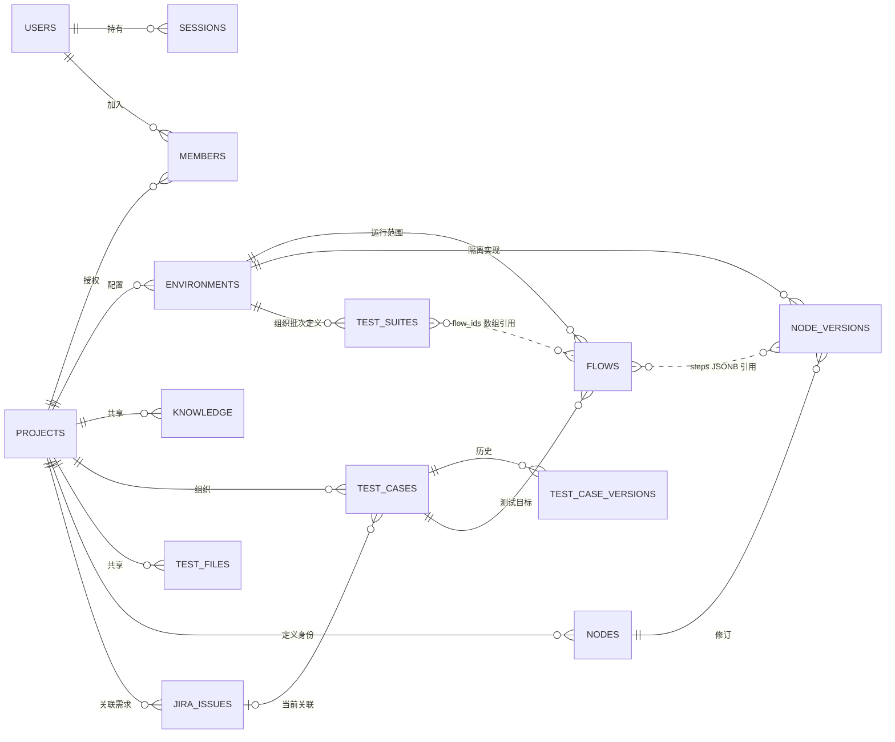

| 表                                       | 主键与重要约束                                                                                   | 用途                               |
| ---------------------------------------- | ------------------------------------------------------------------------------------------------ | ---------------------------------- |
| `users`、`sessions`、`members`           | 用户 UUID，邮箱唯一。会话以 token 摘要为主键。成员主键 `(project_id,user_id)`，角色受 CHECK 限制 | 身份、到期会话和项目授权           |
| `projects`、`environments`               | 项目和环境各有 UUID。环境名称在项目内唯一                                                        | 项目边界、环境变量和凭据、归档标记 |
| `knowledge`                              | UUID，项目 FK                                                                                    | 项目知识文档、更新时间             |
| `test_cases`、`test_case_versions`       | 当前用例 UUID。历史主键 `(case_id,version)`，保留标题、说明、关联和创建者                        | 草稿、当前版本、历史证据           |
| `nodes`、`node_versions`                 | 节点身份 `(project_id,key)` 唯一。版本 UUID 单独标识 `(node_id,environment_id,version)`          | 可复用节点及固定修订               |
| `flows`                                  | UUID，项目、环境、用例和创建者 FK。历史 `case_version` 和 JSONB 步骤的版本引用由应用解析         | 可重放流程及分类                   |
| `test_suites`                            | UUID，项目、环境、创建者 FK，`flow_ids` 保存顺序                                                 | 批次定义                           |
| `test_files`                             | UUID，项目、创建者 FK，内容 `bytea`，存大小、MIME 和 SHA-256                                     | 项目共享的不可变测试数据           |
| `jira_issues`                            | UUID，`(project_id,origin,issue_key)` 唯一                                                       | 站点与 Ticket 的最新需求快照       |
| `jira_adapters`、`jira_adapter_versions` | 当前适配器主键 `(project_id,origin)`，历史附 `revision`                                          | 站点选择器与可选配置的可追溯版本   |

### 4.3 对话、运行与证据关系

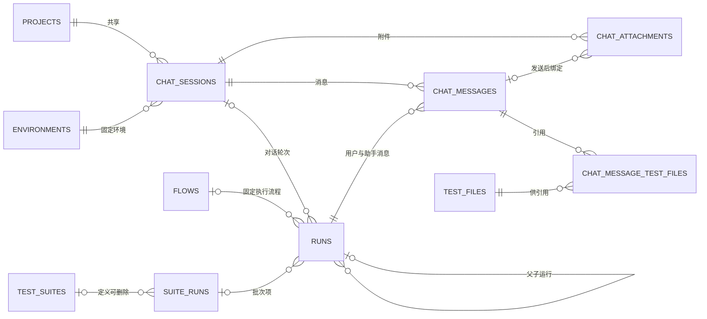

运行以独立证据记录连接报告、接管和 Jira 回写。

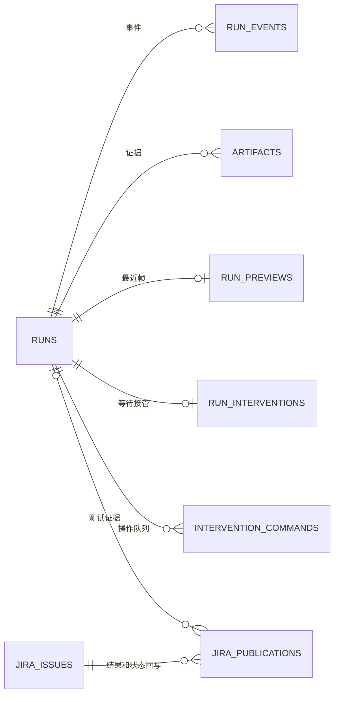

| 表                                            | 实现约束与保留方式                                                                                                                                                               |
| --------------------------------------------- | -------------------------------------------------------------------------------------------------------------------------------------------------------------------------------- |
| `chat_sessions`                               | 归属项目与环境，绑定用例和可选修复节点，记录创建者、标题、更新时间和归档时间                                                                                                     |
| `chat_messages`                               | UUID 与全局递增 `seq`。每个运行每种角色至多一条。`(conversation_id,author_id,client_id)` 用于提交幂等                                                                            |
| `chat_attachments`、`chat_message_test_files` | 附件字节入库，未发送时 `message_id` 为空。库文件只保存关联，主键 `(message_id,file_id)`，每条消息的位置唯一                                                                      |
| `runs`                                        | 记录项目、环境、用例、流程、请求人、模式、状态、取消标记、心跳、执行器、会话及批次或父运行。部分索引覆盖排队任务及活动会话唯一性。回放前保存环境、用例、流程、节点版本和参数快照 |
| `run_events`、`artifacts`                     | 事件 ID 递增，按 `(run_id,id)` 增量读取。截图和其他证据按运行 UUID 关联，附件字节用 `bytea`                                                                                      |
| `suite_runs`                                  | 保存批次名与环境，统计从子运行聚合。删除定义时 `suite_id` 可置空，运行保留其批次位置和名称快照                                                                                   |
| `run_previews`                                | 每运行一行，保存请求时间、状态、帧 ID、元数据与 JPEG。执行完成后清理，区别于长期保存的截图证据                                                                                   |
| `run_interventions`、`intervention_commands`  | 等待接管状态和有序命令，命令支持错误与响应字节。活跃状态随运行清理，命令完成后清理敏感操作内容，旧命令由后台回收                                                                 |
| `jira_publications`                           | 关联项目与 Ticket，测试结果可关联来源运行。保存操作类别、状态、摘要、去重标识和请求人                                                                                            |

运行、消息、环境和用例等归属的跨表一致性由应用查询、事务和外键共同维护。外键的级联设置负责特定父行删除时的引用处理，用户操作以归档和保留历史为主。流式事件和预览读取都按所属项目授权，个人记忆工具事件只记录动作与状态。运行执行快照记录当时使用的资产，并对已知环境凭据值脱敏。结果报告的普通展示仍可能从当前用例和环境记录读取名称，以快照核对实际执行版本。

### 4.4 持久化位置与共享范围

| 位置                                                      | 数据                                                                                                                      | 服务实例之间的行为                                                            |
| --------------------------------------------------------- | ------------------------------------------------------------------------------------------------------------------------- | ----------------------------------------------------------------------------- |
| PostgreSQL `qa`                                           | 用户和 session 摘要、共享项目资产、环境加密凭据、模型及应用配置、聊天、任务、执行证据、人工接管、实时预览及 Jira 阶段数据 | 连接同一数据库的实例可按权限访问同一记录，凭据和模型配置由同一数据库提供      |
| `.data/personal-memory/` 或 `LOOPLAB_PERSONAL_MEMORY_DIR` | 每个账号一个本地 bare Git 仓库，保存个人记忆及历史                                                                        | 由接收任务的服务实例读取自己的目录，数据库承担账号识别                        |
| `.data/jira-sessions/<用户 ID>/<项目 ID>/<站点哈希>.json` | 同一用户、项目与站点的 Playwright Jira 登录状态                                                                           | 仅 Jira 执行所在机器读取，按用户与项目隔离                                    |
| 浏览器上下文和执行器内存                                  | 当前页面、元素与事件观察、会话执行器状态                                                                                  | 跟随活跃运行，浏览器关闭后释放                                                |
| `dist/`、`web-dist/`、`.data/` 内验收产物                 | 编译结果、前端静态资源、验收脚本产生的结果和临时文件                                                                      | 本机生成，源码库忽略运行数据。独立导出脚本可在自己的运行目录生成 `artifacts/` |

<a name="chat"></a>

## 5. 对话与 Agent

### 5.1 从项目入口到一次运行

`/projects/:pid/agent?env=<环境 ID>&chat=<会话 ID>` 是交互入口。用例页的「与 Agent 生成」、流程页的「与 Agent 创建流程」、节点页的「Agent 修复」、Jira 分阶段按钮和文件库的对话入口均汇到这里。固定流程可从流程列表直接执行，也可加入测试组。程序客户端可通过 `POST /api/projects/:pid/runs` 发起 `generate`、`repair` 或 `execute`。 [AgentChat.tsx](../web/src/admin/AgentChat.tsx) · [Resources.tsx](../web/src/admin/Resources.tsx) · [routes.ts](../src/server/routes.ts)

一个会话固定所属项目、环境、关联用例及可选修复节点。顶栏切换环境时清掉当前 `chat` 参数。无指定用例时创建草稿用例，只有编排并保存其测试流程时才将该草稿转成正式用例。修复入口在未指定用例时，查找该环境下最新引用目标节点的流程，取它的用例 ID。会话与已发送消息按项目成员权限共享。编辑者和所有者可发送，归档的项目、环境或会话会阻止相关写入。 [chat.ts](../src/server/chat.ts) · [worker.ts](../src/server/worker.ts)

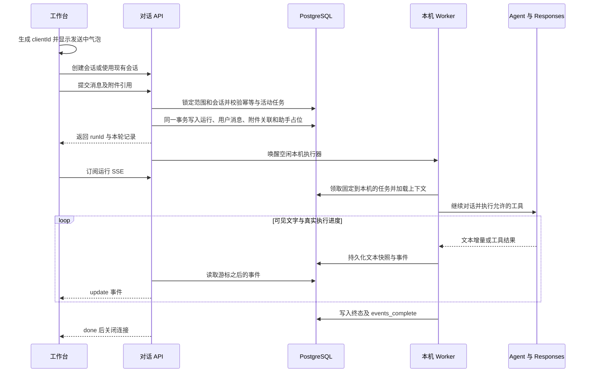

| 路由                                            | 输入与行为                                                                                                                                                |
| ----------------------------------------------- | --------------------------------------------------------------------------------------------------------------------------------------------------------- |
| `GET /api/projects/:pid/chat/sessions`          | 必填 `environmentId`，可按 `q`、`archived` 筛选，`page` 从 1 起。按 `updated_at DESC,id` 排序，每页 30 条。                                               |
| `POST /api/projects/:pid/chat/sessions`         | 接收 `environmentId`、可选 `caseId`、`repairNodeId` 和 `title`。标题最长 120 字符，默认为「新对话」。首次发送用文本或附件数量替换默认标题，取前 60 字符。 |
| `GET /api/chat/sessions/:sid`                   | 用 `before` 消息序号向前翻页，最多取 50 条，返回时按时间正序。一起返回选中消息关联的附件、文件库引用、产物元数据和最近 25 条运行。                        |
| `PATCH /api/chat/sessions/:sid`                 | 重命名、归档或恢复。会话存在 `queued` 或 `running` 任务时，归档返回 409。                                                                                 |
| `POST /api/chat/sessions/:sid/messages`         | `clientId` 为 UUID，消息文字去首尾空白后最长 20,000 字符，可只发附件。按 `会话 × 作者 × clientId` 去重，同一请求返回已有 `runId`。                        |
| `POST /api/chat/sessions/:sid/runs/:rid/cancel` | 检查会话写权限及运行归属，走统一取消入口。已持久化的消息、工具副作用和运行记录保留。                                                                      |
| `GET /api/chat/sessions/:sid/runs/:rid/stream`  | 通过 `Last-Event-ID` 或 `after` 恢复，返回 `run`、`events`、`cursor`、`hasMore`。                                                                         |

发送事务先锁住活动项目和环境，再锁定会话。重复 `clientId` 检查先于活动运行冲突检查。新消息遇到同会话活动运行返回 409。`chat_messages` 的唯一约束同时保护 `run_id × role` 和会话内作者请求幂等。每条用户消息有实际 `author_id`，对应助手回复和独立运行，当前操作者记入 `runs.requested_by`，聊天任务记入 `executor_id`，因此浏览器、Jira 登录状态和个人记忆留在接收请求的本机执行器。 [chat.ts](../src/server/chat.ts) · [db.ts](../src/server/db.ts) · [executor.ts](../src/server/executor.ts)

### 5.2 即时发送、恢复与流式状态

| 层         | 具体行为                                                                                                                                                                                                 | 取舍                                                                                             |
| ---------- | -------------------------------------------------------------------------------------------------------------------------------------------------------------------------------------------------------- | ------------------------------------------------------------------------------------------------ |
| 草稿       | 文本、选中的文件库引用按项目加会话或环境写入 `sessionStorage`。本地上传先写服务端未绑定消息的附件。草稿会话按需创建并迁移本地草稿。                                                                      | 浏览器刷新可恢复已有会话的未发内容。同一个标签页内的重试 ID 由内存 outbox 管理。                 |
| 发送       | 前端先渲染用户气泡和「发送中」，清空当前输入。等 API 返回后合并消息与运行，按作者和 `clientId` 消除重复气泡，立即建立 SSE。请求失败时在仍处于原会话的条件下恢复输入。                                    | 输入反馈无需等待模型或事务。发送、上传及会话创建有前端锁，跨标签页冲突仍由服务器约束处理。       |
| 消息写入   | `chatWriter` 约每 150 ms 合并增量。消息正文与 `agent_text` 事件在同一事务写入，事件携带当前完整可见文本。每轮模型回复结束、结果追加与最终收尾时强制同步。                                                | 完整快照便于重连替换，避免重复拼接。已知凭据的未完整前缀在增量尾部暂缓输出，持久化前替换凭据值。 |
| SSE        | 每批取最多 200 条事件。批满时立即继续，未满时隔 400 ms 查询。连接建议 1,500 ms 重试，约每 15 秒发送心跳，约每 5 秒复查成员与会话有效性。                                                                 | 事件源是持久化 PostgreSQL 记录，刷新后可重读。写缓冲超限时关闭连接，客户端从已接收的游标恢复。   |
| 终止       | 非活动终态且 `events_complete=true`，最后一批已读完才发 `done`。成员会话失效时发 `forbidden` 后结束，异常连接可重连。                                                                                    | 状态与最后事件分开确认，客户端能收齐报告与最终回复。                                             |
| 客户端同步 | `EventSource` 按 ID 去重，用最新 `agent_text` 替换助手气泡，动态列表保留最近 120 条非正文事件。`done` 后更新聊天、会话列表、项目资产和 Jira 查询。空闲对话每 10 秒重新取当前会话，后台标签页暂停此轮询。 | 最近窗口用于交互，运行报告仍可查持久化事件。运行继续由 Worker 执行，关闭页面不取消运行。         |
| 界面       | Ant Design X 的 `Conversations`、`Bubble.List`、`Sender` 负责会话、气泡和输入。Markdown 由 `react-markdown`、`remark-gfm` 渲染，远程图片替换为文字。对话和运行报告入口可打开实时浏览器或人工接管。       | 对话状态区显示真实动作、产物与验证状态，模型私有推理留在协议内部。                               |

`agent_status` 表示阶段、`agent_tool_start/end` 表示调用、`agent_message` 表示某次模型回复结束、`agent_text` 更新可见正文。`node_saved`、`flow_saved`、`case_saved`、知识和记忆事件说明资产动作。`flow_execution`、`step`、`run_passed`、`run_failed` 等记录实际运行。会话以 `completed` 结束表示本轮请求已经回复或保存，测试是否通过以独立运行结果为准。 [chat-runtime.ts](../src/server/chat-runtime.ts) · [chat.ts](../src/server/chat.ts) · [AgentChat.tsx](../web/src/admin/AgentChat.tsx) · [worker.ts](../src/server/worker.ts)

### 5.3 附件、文件库引用与上下文窗口

| 内容           | 校验和授权                                                                                                                                                                                 | 模型侧用法                                                                                                                                           |
| -------------- | ------------------------------------------------------------------------------------------------------------------------------------------------------------------------------------------ | ---------------------------------------------------------------------------------------------------------------------------------------------------- |
| 会话图片       | PNG、JPEG、WebP 同时匹配后缀与签名。上传使用 Base64 JSON，文件名清理路径和控制字符。                                                                                                       | 转成 `input_image`，编码为 data URL，细节模式 `auto`。                                                                                               |
| 会话 PDF       | `.pdf` 后缀和 `%PDF-` 签名。                                                                                                                                                               | 转成有文件名的 `input_file`。                                                                                                                        |
| 会话文本       | `txt`、`md`、`csv`、`json`、`yaml`、`yml`、`ts`、`tsx`、`js`、`jsx`、`feature`、`log`，要求有效 UTF-8 和无 NUL，最多 200,000 字节。                                                        | 作为外部资料文本，单份默认节选最多 40,000 字符。`read_attachment` 仅可读本会话已发送文本，按 `offset` 每次取最多 20,000 字符并返回 `nextOffset`。    |
| 项目文件库引用 | 按 `file_id` 关联原文件与引用顺序，当前项目且 ID 唯一。归档后既有引用仍有效。UI 选择器默认列出未归档文件。                                                                                 | 记录文件 ID、名称、MIME、大小及归档状态。根据签名和字节识别图片、PDF 与 UTF-8，其他二进制仅提供引用。浏览器可按 ID 执行 `uploadFile` 或 `readFile`。 |
| 单次限制       | 会话临时上传单文件 1 B 到 5 MiB，上传端点请求体限制 8 MiB，Base64 字符串上限 `7 * 1024 * 1024`。单会话已存临时上传总量 50 MiB、100 个。单条消息临时附件与文件库引用合计最多 5 个、12 MiB。 | 二进制上下文共享 12 MiB 总预算。较早图片或 PDF 超预算时提示省略。文件库引用仍可在浏览器按 ID 使用。                                                  |

上传 `POST /api/chat/sessions/:sid/attachments` 产生 `message_id=null` 草稿，详情只列本人的草稿，删除端点也只删除本人未绑定的附件。发送时校验上传者、会话、未绑定状态和重复 ID，再原子绑定到用户消息。`GET /api/chat/attachments/:aid` 按项目成员校验下载，当前按 UUID 直取的权限规则对草稿与已发送附件相同。返回 `private, no-store`、`nosniff` 和沙箱 CSP，图片内联，其他文件作为附件。临时附件与库文件都是资料，文件内代码不会交给服务器执行。 [chat.ts](../src/server/chat.ts) · [chat-files.ts](../src/server/chat-files.ts) · [chat-runtime.ts](../src/server/chat-runtime.ts)

Worker 以当前用户消息的 `seq` 为边界，从新到旧选最多 40 条消息，分配 120,000 字符的历史正文和文本节选预算，再恢复正序。二进制预算在相同遍历顺序中扣除。该预算计入消息正文和资料节选，额外的文件说明、项目上下文、系统提示及工具结果各自构造。仅有正文的旧助手消息用于恢复用户可见对话。本轮上下文还加上当前用例、环境 URL 与变量、凭据键名、可复用节点、项目知识、请求者个人记忆及该会话最多 8 条既往运行摘要。修复任务再给目标节点、相关旧流程与最近失败信息。资料作为数据消息，用户当前指令独立位于末尾。窗口截断通过 `olderConversationOmitted` 和 `contextWindowed` 标记。 [chat-runtime.ts](../src/server/chat-runtime.ts) · [worker.ts](../src/server/worker.ts)

<a name="runtime"></a>

## 6. 模型适配与 Agent 运行时

### 6.1 本地循环的来源和协议边界

运行时从 pi 的固定提交 `83692682f095528f8b71652ddacff7075e36e893` 移植，基准 `packages/agent` 为 1.0.1，原版权和 MIT 原文随仓库保留。项目把工具执行管线移植到 `tool-executor.ts`，在 `agent-loop.ts` 保留模型调用、工具回填和队列语义，在 `agent.ts` 实现运行锁、状态和异步订阅。类型和 JSON Schema 校验独立维护。运行与构建只依赖本仓库和锁定的 npm 依赖。 [第三方声明](../THIRD_PARTY_NOTICES.md) · [源码摘要清单](pi-source-manifest.json) · [MIT 许可](../licenses/pi-MIT.txt)

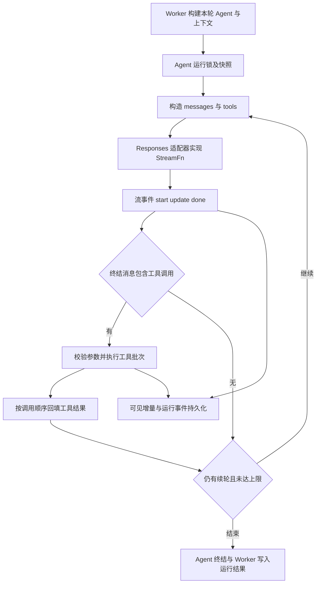

| 模块                                                  | 实际契约                                                                                                                                                                                                                                                                    |
| ----------------------------------------------------- | --------------------------------------------------------------------------------------------------------------------------------------------------------------------------------------------------------------------------------------------------------------------------- |
| [`types.ts`](../src/runtime/types.ts)                 | `Message` 包含 `system`、`user`、`assistant`、`toolResult`。文本、图片和文件是内容块，工具调用携带名称、调用 ID、参数。`StreamFn` 接收消息、工具声明和 `AbortSignal`，产生 `start`、`update`、`done` 异步迭代事件。                                                         |
| [`agent.ts`](../src/runtime/agent.ts)                 | 每次调用占有一个运行锁并创建取消控制器。对外状态和每位订阅者收到的是副本。`prompt` 从新输入开始，`continue` 从现有上下文继续。已有会话恢复的历史不会重发为本次事件。                                                                                                        |
| [`agent-loop.ts`](../src/runtime/agent-loop.ts)       | 构造请求前可 `prepareRequest`、`transformContext`、`convertToLlm`。每轮流结束后处理工具和 `finishTurn`。默认最多 40 轮，业务 Worker 设置 45 轮，最终原因包含 `completed`、`error`、`aborted`、`max_turns`。到上限仍需下一轮才记 `max_turns`，保留排队输入。                 |
| [`tool-executor.ts`](../src/runtime/tool-executor.ts) | 从声明的工具中按名称解析，发开始事件，准备参数、校验、`beforeToolCall`、执行、`afterToolCall`，发结束事件和工具结果消息。参数、未知工具、拦截或执行异常形成工具错误结果，正常工具失败可供模型下一轮修正。                                                                   |
| [`validation.ts`](../src/runtime/validation.ts)       | AJV 严格校验且无类型强制转换，按 schema 对象缓存编译结果，在参数副本上校验。工具声明显式随每次模型请求发送。                                                                                                                                                                |
| 事件与取消                                            | 所有订阅者按序 `await`，工具开始事件是执行副作用前的持久化关口，订阅写入异常拒绝本次运行。取消信号传给模型和工具，未运行的工具补错误结果以保持调用配对。并行批次用 `Promise.allSettled` 等待已启动任务收敛，完成事件按实际顺序，回填按调用顺序。                            |
| 续轮与停机                                            | 默认串行，任一工具标记 `sequential` 即串行整个批次。批次所有工具结果均 `terminate=true` 时停止因工具触发的自动续轮，仍处理显式续轮和输入队列。Steering 在批次边界注入，follow-up 在自然停点注入，包装层均默认每次取一条。工作台每会话一个活动任务，新的用户消息排成新运行。 |

流无终结事件和模型异常转为错误消息，终态前释放迭代器。通用循环收到 `length` 时给其中的工具调用补错误结果并续轮，避免执行截断参数。实际 Responses 适配器把 `incomplete` 记成 `error`，丢弃其中的工具调用并停止本轮。运行时可按 `beforeToolCall` 和 `afterToolCall` 扩展，当前业务权限、范围和写入校验在各工具的服务端实现中落实。 [agent-loop.ts](../src/runtime/agent-loop.ts) · [tool-executor.ts](../src/runtime/tool-executor.ts) · [responses.ts](../src/openai/responses.ts)

### 6.2 Responses 请求、流事件与工具回填

本地 `openai` SDK 负责 Responses 传输。每次模型任务开始时从 `qa.runtime_settings` 读取地址、密钥、模型和版本，任务内包括工具续轮均使用该次快照。更新后的配置供后续任务读取。纯回放不需要模型配置。请求的 SDK 超时为 120,000 ms，`maxRetries=1` 由 SDK 处理适用的重试。Worker 单独管理任务总时限和取消。 [platform-settings.ts](../src/server/platform-settings.ts) · [responses.ts](../src/openai/responses.ts)

| 项目           | 实现                                                                                                                                                                                                                   |
| -------------- | ---------------------------------------------------------------------------------------------------------------------------------------------------------------------------------------------------------------------- |
| 角色与内容     | `system` 映射成 `developer`，`user` 内容转 `input_text`、`input_image`、`input_file`。恢复的文本助手消息映射为 `assistant`。                                                                                           |
| 调用与工具结果 | 使用 `function` 工具声明和 JSON Schema，`strict:false`、`parallel_tool_calls:false`。解析最终 `function_call.arguments` 为对象，使用 `call_id` 将 `function_call_output` 配对，结果 JSON 包含 `isError` 和 `content`。 |
| 续轮状态       | `store:false`，每次传当前完整输入序列。保留本轮原始 `response.output` 为 `responseItems`，包括可回传的加密推理项，在同一 Agent 运行的后续轮按原顺序附回。历史恢复使用数据库中的可见消息及运行摘要。                    |
| 生成参数       | `stream:true`、`include:["reasoning.encrypted_content"]`、`reasoning.effort:"low"`、`max_output_tokens:10000`。                                                                                                        |
| 可见增量       | `response.output_text.delta` 更新部分助手文本并产生 `update`。只在完成响应中取最终文本和完整工具调用，工具参数增量不执行。                                                                                             |
| 终结与失败     | `response.completed/failed/incomplete` 映射为 `done`，失败和不完整结果标记错误。模型拒绝、无法解析参数、`error` 事件与缺终结的流触发失败。连接异常转换为中文网络或超时提示，释放 SDK 流。                              |
| 凭据           | Worker 解密环境凭据后把键名交给模型，在浏览器中解析 `{{secret.key}}`，已知环境凭据及 API Key 从上下文、工具返回和可见事件中脱敏。测试文件内容参与调查时，相关工具的共享事件只保留必要元数据。                          |

### 6.3 聊天、编排与验证如何交接

| 请求                           | Agent 可调用的阶段                                                                                                           | 完成条件                                                                                |
| ------------------------------ | ---------------------------------------------------------------------------------------------------------------------------- | --------------------------------------------------------------------------------------- |
| 问答、需求阅读、保存知识或偏好 | 回复或调用对应的读取、保存工具。对话运行首次需要浏览器时才打开。                                                             | `completed` 表示完成本轮对话，实际工具动作见事件。                                      |
| 保存用例、编排但暂不执行       | `list_test_cases`、`read_test_case`、`save_test_case`、`list_nodes`、`save_node`、`save_flow`。                              | 保存所选用例和版本，检查节点与环境归属、参数和断言。`save_flow` 返回 `executed:false`。 |
| 独立执行已保存流程             | `run_flow` 发起子运行，通过真实浏览器回放后把结果交还模型。                                                                  | 子运行的持久化状态和证据决定结果。Agent 可继续执行用户明确要求的后续阶段。              |
| 编排后立即独立验证             | `finish_flow` 返回 `terminate=true` 并设置当前运行的流程，Agent 结束后关闭调查浏览器，启动全新浏览器执行固定版本。           | 至少一项断言且所有步骤通过，运行才是 `passed`。                                         |
| 修复                           | 只保存目标逻辑节点的新版本，原断言预期不能被移除或削弱。有旧流程时须核对它固定的用例版本，保持顺序、参数和其他节点版本一致。 | 新流程回放按真实结果收尾，原版本可追溯。                                                |
| 确定性回放                     | `execute` 模式直接加载流程、用例和节点版本并保存脱敏快照。                                                                   | 无模型调用，按步骤和断言写报告，见浏览器执行章节。                                      |

Worker 订阅运行时事件以构造用户可见进度和回复，通过 `report_progress` 补充可观察的阶段说明。流程保存、工具调用成功和浏览器断言通过分别记录。单机调度、取消、父子运行和测试组的事务语义见运行执行章节。 [worker.ts](../src/server/worker.ts)

<a name="memory"></a>

## 7. 项目知识与个人记忆

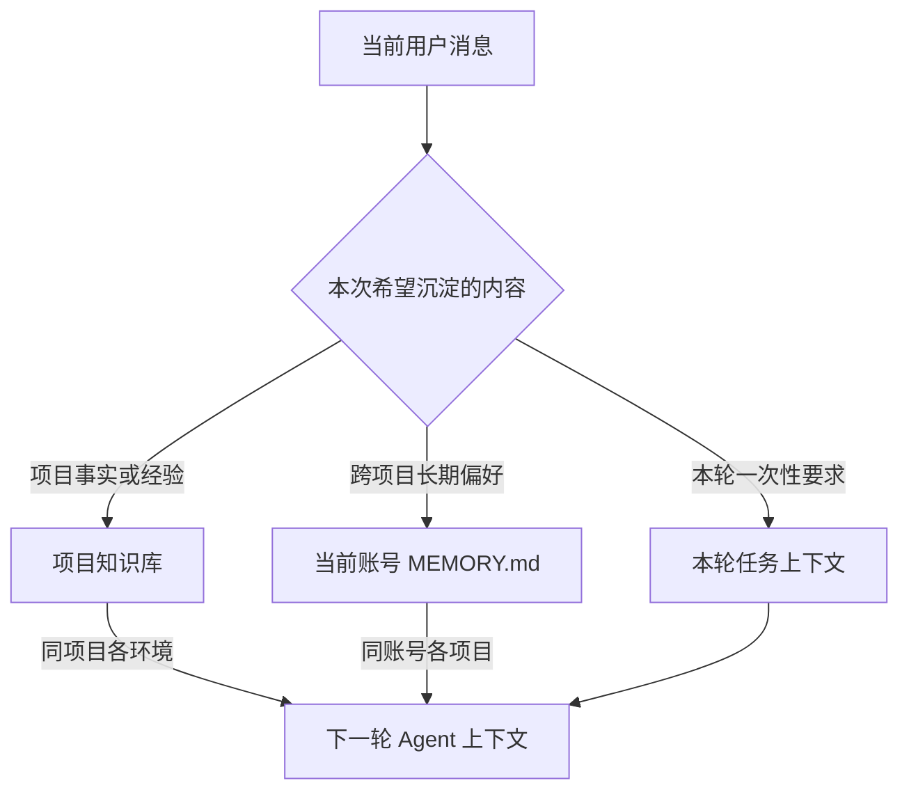

| 维度       | 项目知识库                                                                                                 | 个人记忆                                                                                                                                  |
| ---------- | ---------------------------------------------------------------------------------------------------------- | ----------------------------------------------------------------------------------------------------------------------------------------- |
| 内容       | 业务术语、页面路径与选择器、接口约定、经过验证的项目经验。                                                 | 测试与汇报偏好，长期适用的工作习惯。                                                                                                      |
| 归属       | PostgreSQL `knowledge.project_id`，同一项目跨环境共享。                                                    | 当前发起运行的账号 `requested_by`，同一服务本机跨项目使用。                                                                               |
| 默认加载   | 按 `updated_at DESC,id` 取最近 8 份，每份前 2,400 字符。多取一条探测更多结果，任一节选截断也置 `hasMore`。 | 从账号仓库当前提交读一份 `MEMORY.md`，写入时最多 6,000 字符，读到空文档时省略正文。                                                       |
| 修改与版本 | 项目所有者、编辑者手动编辑或明确委托 Agent。保存更新原条目和 `updated_at`，删除移除对应记录。              | 账号页面或对话明确表明长期偏好后保存全量 Markdown，按提交 SHA 校验版本。清空是空文档提交，旧提交保留。                                    |
| 可见性     | 项目成员可读取，知识保存的事件显示文档标题和 ID。                                                          | 正文通过当前账号的 API 返回。共享运行事件记录有无加载、写入成功或不可用等状态，不记录个人记忆工具参数和结果。协作回复与产物仍可体现偏好。 |
| 内容优先级 | 项目规则、当轮要求和验证标准优先。工具读取与默认加载的知识都是参考数据。                                   | 相关偏好用于生成、修复与汇报，不构成额外操作授权。对话中由其他成员、旧消息、页面或附件提出的内容不触发个人偏好写入。                      |

### 7.1 项目知识读写

`POST /api/projects/:pid/knowledge` 新建，`PUT` 和 `DELETE /api/projects/:pid/knowledge/:kid` 更新或删除。管理页列表查询走 `GET /api/projects/:pid/resources/knowledge`，资源定位受项目权限约束。文档标题修剪后长度 1–120 字符，正文 1–60,000 字符，支持文字与 Markdown。Agent 非纯回放运行自动读取节选并记录 `knowledge_loaded`。 [knowledge.ts](../src/server/knowledge.ts) · [routes.ts](../src/server/routes.ts) · [management.ts](../src/server/management.ts)

| 工具             | 参数与分页                                                                                                        | 权限与写入语义                                                                                                  |
| ---------------- | ----------------------------------------------------------------------------------------------------------------- | --------------------------------------------------------------------------------------------------------------- |
| `list_knowledge` | 按字面子串在标题或正文 `ILIKE` 搜索，最多 200 字符，`offset` 分页。返回 20 条 ID、标题、更新时间及 `nextOffset`。 | 只查询本项目，转义 `%`、`_` 和反斜杠。                                                                          |
| `read_knowledge` | 用文档 UUID 和 `offset` 精确读取，正文每次最多 10,000 字符，返回下页偏移。                                        | 校验项目归属，工具完成事件用占位文字代替正文。                                                                  |
| `save_knowledge` | 提交标题与完整正文，可选 ID。提供 ID 时更新已有文档。                                                             | 只装配到聊天运行，重查项目写权限，拒绝已知凭据。工具开始事件省略参数，成功发 `knowledge_saved` 并连接到知识库。 |

典型用户请求「把这个发现记下来」由 Agent 从当轮、相关对话和已记录运行结果确定所指，先查找可合并条目。整理时保留仍适用的内容，区分已验证结果、用户描述与假设，按需附来源运行 ID。页面、附件和旧对话中的命令不授权写入。 [worker.ts](../src/server/worker.ts)

### 7.2 个人记忆的 Git 写入协议

默认目录为 `.data/personal-memory`，可用 `LOOPLAB_PERSONAL_MEMORY_DIR` 配置。仓库路径为目录下 `<SHA-256(账号 UUID)>.git`，分支 `refs/heads/main`，对象格式 SHA-1，文件 `MEMORY.md`。实现借鉴本机 Duet 的按账号隔离、固定 `MEMORY` 预读和 ref 并发校验，LoopLab 用 TypeScript 和本机 Git CLI 完成读写。每个仓库使用本地磁盘，实例间共享 PostgreSQL 时仍各读自己的目录。 [personal-memory.ts](../src/server/personal-memory.ts) · [config.ts](../src/server/config.ts)

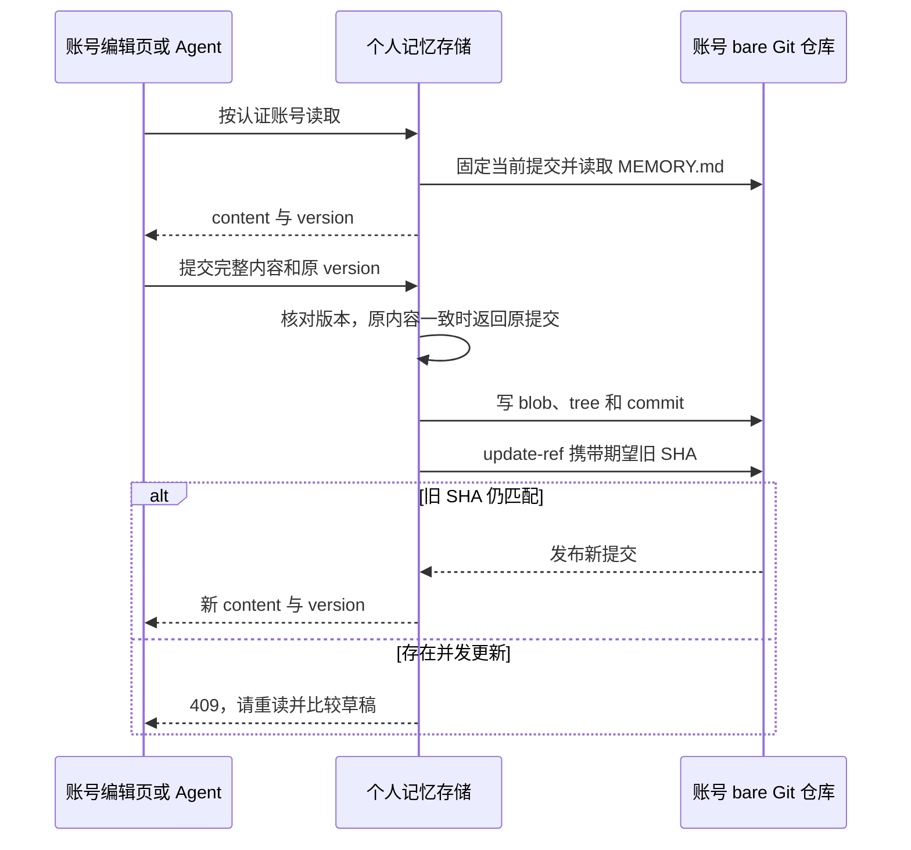

- `GET /api/me/memory` 只取当前登录账号，返回 `{content, version}`。空仓库返回空内容和 `null`，读取不会创建仓库。已有仓库先定位当前提交，再从该提交读 `MEMORY.md`。
- `PUT /api/me/memory` 要求完整正文和 `version`。版本为 `null` 或 40 位小写十六进制 SHA，正文去首尾空白后最多 6,000 字符。两个接口返回 `private, no-store`。手工 API 拒绝配置中的已知 API Key，Agent 保存另外拒绝当前环境已知凭据。
- 首次写入通过临时目录初始化 bare 仓库并原子重命名。用 `hash-object`、`mktree`、`commit-tree` 创建对象，用带期望旧 SHA 的 `update-ref` 发布。旧版本在内容比较前先判冲突，相同内容复用原提交。`Memory-Source` 记录 `account` 或 `run:<运行 ID>`。Git 以参数数组和标准输入调用，每条命令超时 10 秒，使用服务身份，不执行仓库钩子或签名。
- 页眉 `/memory` 页面按账号分隔查询缓存，显示当前版本、文本、保存与清空。遇到 409 保留草稿，重新读取后可对照服务器版选择继续编辑或替换草稿。清空用空内容写入新版本，之后运行不再加载当前正文，Git 历史仍保留。
- `save_personal_memory` 仅在聊天运行且个人存储读取可用时装配。Agent 根据当轮明确的长期偏好、修正或忘记指令更新全文，以启动时读取的版本写入并在本轮跟踪新版本。加载成功记录 `personal_memory_loaded`，改动记录 `personal_memory_saved`，读取错误记录 `personal_memory_unavailable` 并继续原任务。账号 API 对存储故障返回 503。

用户当轮表达与账号页是主动更新入口。项目知识采用分页文本搜索，个人偏好采用一份有上限的 Markdown。固定版本测试的直接回放跳过两者和模型。 [personal-memory.ts](../src/server/personal-memory.ts) · [PersonalMemory.tsx](../web/src/admin/PersonalMemory.tsx) · [worker.ts](../src/server/worker.ts)

<a name="browser"></a>

## 8. 测试流程与浏览器

### 8.1 从目标到可复现的证据

流程把一次 Agent 调查的成果固化为按顺序执行的节点版本。节点的逻辑键可跨环境复用，实现版本属于具体环境。保存流程时固定用例版本和每项 `revisionId`，执行时读取该环境当时的地址、变量和凭据。因而节点升级不会改变已有流程，环境配置和被测站点的变化仍会影响重放。实现入口见 [`repository.ts`](../src/server/repository.ts)、[`worker.ts`](../src/server/worker.ts) 和 [`browser.ts`](../src/testing/browser.ts)。

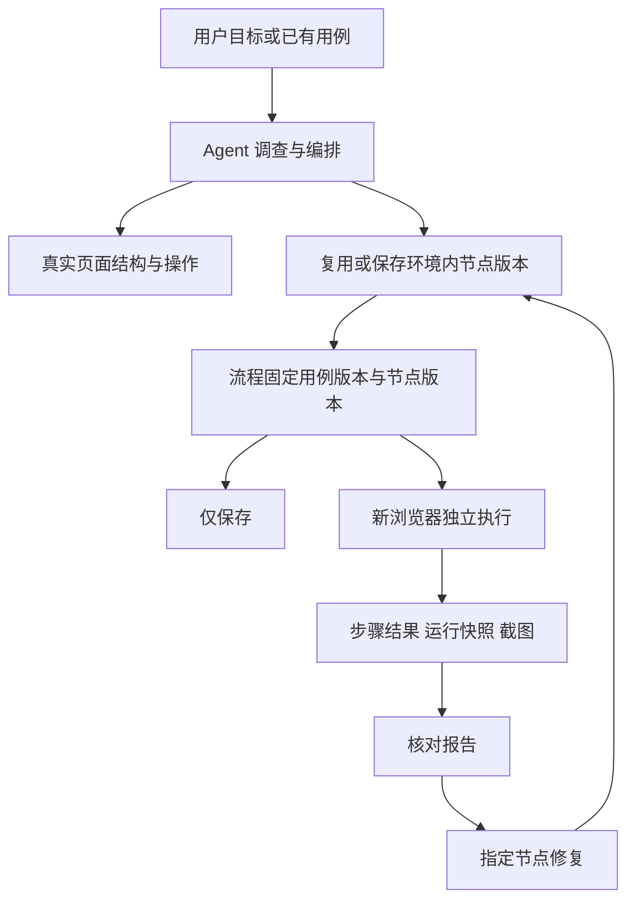

| 路径                                | 关键处理                                                                                                                                                                    | 结果                                                                  |
| ----------------------------------- | --------------------------------------------------------------------------------------------------------------------------------------------------------------------------- | --------------------------------------------------------------------- |
| `browser_inspect`、`browser_action` | 聊天在需要调查时打开浏览器。`browser_action` 校验并执行一个 DSL 动作，再返回页面信息。`browser_inspect` 读取 URL、标题、最多 24,000 字符的 ARIA 快照和前 100 个候选元素属性 | 调查输入。页面文本按外部数据处理，调查成功不代表独立重放通过          |
| `list_nodes`、`save_node`           | 查询当前环境每个节点的最新版本。保存时校验 spec，当前环境最后一版 spec 相同则复用版本。工具会拒绝把已知环境凭据明文写入 spec                                                | 节点和确切的 `revisionId`                                             |
| `save_flow`                         | 读取选定用例及版本，校验项目、环境、节点输入和至少一个断言，保存流程后允许 Agent 继续当前轮                                                                                 | 流程 ID、用例版本、`executed: false`。需要独立运行时再调用 `run_flow` |
| `finish_flow`                       | 使用同一编排校验。成功后结束 Agent 编排，关闭调查浏览器，以新浏览器执行固定流程                                                                                             | 只在实际回放结束后报告通过或失败                                      |
| `run_flow`                          | 当前对话按流程 ID 执行当前环境已有流程。在同一执行器创建 `mode=execute` 的子运行，独立打开浏览器；预览和接管沿用父运行 ID                                                   | 子运行 ID、实际状态和汇总，随后可以按需要核对证据或回写 Jira          |
| 普通回放                            | `POST /api/projects/:pid/runs` 的 `mode=execute` 验证流程属于指定项目、环境、用例，再走固定流程执行路径                                                                     | 普通回放和测试组子项不调用模型，也不重新生成节点                      |

`POST /api/projects/:pid/flows` 接收 `{ environmentId, caseId, name, steps, category?, expectedCaseVersion? }`。`expectedCaseVersion` 提供时，保存事务内核对当前用例版本，过期返回 `409`。编排工具在传入 `caseId` 时要求提供 `caseVersion`。新保存的流程固定 `case_version`，`case_version = NULL` 表示用例版本未知，独立执行这些流程时读取当前用例。对话草稿在编排正式流程时可转为正式用例并保存对应版本。模型编排入口与实际运行均检查至少一项断言，手工流程 API 本身验证节点归属与输入，断言门槛由执行端落实。

修复模式从指定节点在当前环境的最新实现读取断言基线，从同用例、同环境最近保存的流程读取编排基线。`save_node` 只接受目标节点键。旧 `assertText` 和 `assertValue` 的期望内容按同一个 `assertContent` 签名计数，`assertVisible` 按存在次数保留，因此允许改选择器及以相同期望值把表单检查改为 `assertValue`。已有编排基线时，流程校验要求原长度、原节点顺序、各项输入和无关节点版本保持一致，并沿用原分类。原流程的用例版本过时或未知时，先核对当前用例再重新编排，避免将旧断言误记成覆盖新需求。修复保存新流程，变化的 spec 形成新节点版本。原流程引用仍可复跑。

### 8.2 节点 DSL 与参数求值

[`spec.ts`](../src/testing/spec.ts) 定义 `NodeSpec = { inputs, steps }` 和 `FlowStep = { revisionId, params }`。每个节点允许 1–40 个动作和最多 30 个输入名，每个流程包含 1–40 个节点。输入名与输出名匹配 `[a-zA-Z][a-zA-Z0-9_]*`。选择器长度 1–1,000，常规字符串长度 1–4,000，表单值和流程参数最长 10,000 个字符且允许空串。`timeoutMs` 如提供，须为 1,000–180,000 的整数。模型工具的 `stepJson` 描述字段与动作枚举，落地时 `stepSchema` 按动作严格校验字段。

| 值来源         | 写法                  | 求值约定                                                                                   |
| -------------- | --------------------- | ------------------------------------------------------------------------------------------ |
| 当前环境基址   | `{{baseUrl}}`         | 流程导航可使用相对路径，基址来自所选环境                                                   |
| 节点输入       | `{{param.message}}`   | `params` 必须包含节点声明的输入；参数值内还可替换 `{{output.name}}`                        |
| 环境变量       | `{{var.region}}`      | 从当前环境配置读取字符串                                                                   |
| 环境凭据       | `{{secret.username}}` | 执行器加载环境时解密，在动作前替换。模型上下文提供环境凭据的键名                           |
| 浏览器运行输出 | `{{output.reply}}`    | `extractText` 或 `readFile` 先设置输出，后续步骤在同一浏览器会话消费；独立重放从空输出开始 |

未知模板命名空间和缺少值会在解析时报错。`param` 仅做上述 `output` 内层替换，普通值不做任意递归求值。`uploadFile` 与 `readFile` 使用当前项目的文件 ID，已归档文件仍可由已有引用读取。文本读取使用严格 UTF-8 解码，含 NUL 或非法编码时失败。流程中使用文件文本的失败步骤隐藏文件内容，文件读写工具的事件与附件上下文见第 5 节。

| 动作              | 字段（除 `action`）               | 执行语义                                                          |
| ----------------- | --------------------------------- | ----------------------------------------------------------------- |
| `navigate`        | `url`                             | 相对环境基址解析，检查允许的 origin，等待 `domcontentloaded`      |
| `reload`          | 无                                | 刷新并等待 `domcontentloaded`                                     |
| `fill`            | `selector`, `value`               | 填写表单值                                                        |
| `click`           | `selector`                        | 按 DOM/Playwright 定位器点击                                      |
| `press`           | `selector`, `key`                 | 对元素发送 Playwright 按键                                        |
| `uploadFile`      | `selector`, `fileId`              | 以文件库原始字节、文件名和 MIME 类型提交给文件输入                |
| `readFile`        | `fileId`, `output`                | 把文件的 UTF-8 文本设置为运行输出                                 |
| `extractText`     | `selector`, `output`              | 读取 `innerText` 并存入运行输出                                   |
| `assertText`      | `selector`, `text`, `timeoutMs?`  | `toContainText` 检查元素文本，默认等待 20 秒                      |
| `assertValue`     | `selector`, `value`, `timeoutMs?` | `toHaveValue` 检查表单当前值，默认等待 20 秒                      |
| `assertVisible`   | `selector`, `timeoutMs?`          | `toBeVisible`，省略时间时沿用 Playwright `expect` 默认值          |
| `waitFor`         | `selector`, `timeoutMs?`          | 等元素可见                                                        |
| `waitForHidden`   | `selector`, `timeoutMs?`          | 等元素隐藏或脱离 DOM                                              |
| `waitForResponse` | `url`, `timeoutMs?`               | 步骤开始后等待 URL 包含指定字符串的响应；匹配本身不检查 HTTP 状态 |
| `screenshot`      | `name`                            | 保存全页 PNG，禁用截图动画并遮罩密码输入框                        |
| `pauseForHuman`   | `message`                         | 发出显式接管请求，等待人工继续                                    |
| `watchElement`    | `selector`, `message`             | 监听元素从不可见变为可见，可重复触发                              |
| `watchDialog`     | `message`                         | 监听原生弹框，将确认、取消或输入交给人                            |
| `watchResponse`   | `url`, `message`                  | 订阅后续 URL 子串匹配的响应，触发人工接管                         |
| `clearWatchers`   | 无                                | 清除监听器                                                        |

`waitForResponse` 无法等待早于该步出现的响应。若操作可能立即发出响应，在操作前设置 `watchResponse`，并为成功标准保留单独断言。节点采用声明式顺序执行，DSL 没有任意 JavaScript、命令执行、分支、循环或子流程。这个限制让动作参数可审查，并可用同一份 spec 构建独立导出脚本。

### 8.3 浏览器生命周期、证据与导出

`BrowserSession` 启动无头 Chromium，`PLAYWRIGHT_CHANNEL` 可选本机 Chrome。每次打开创建 1,440 × 960 视口的新上下文，普通环境不载入之前的登录状态。默认操作超时为 12 秒，首次导航单独用 30 秒。普通目标的显式导航与导航路由检查环境 origin；该检查针对导航请求，常规页面子资源仍由浏览器加载。Jira 的登录例外见第 10 节。DOM 定位器承担自动执行，人工接管界面另有坐标点击。

执行端先把流程、环境 ID/名称/基址/变量、用例及解析到的节点版本写入 `runs.snapshot`，过滤已知环境凭据；之后才打开重放浏览器。每个节点发 `node_start` 和通过后的 `node_passed`，每一步发 `step` 的 `start`、`passed` 或 `failed`。首个失败步骤终止本条流程。节点完成后检查并清理监听，保存 `final.png`，仍持有租约且未取消才写入 `passed`。普通失败在浏览器仍可操作时尽力保存 `failure.png`，取消和关闭后的浏览器不保证能截图。已经保存的节点和流程不会因失败回滚。

| 证据入口                                      | 契约                                                                                                                                            |
| --------------------------------------------- | ----------------------------------------------------------------------------------------------------------------------------------------------- |
| `GET /api/runs/:rid`                          | 项目成员可读。完整请求返回含快照的运行、按事件 ID 排序的事件（最多 10,000 条）和产物元数据                                                      |
| `GET /api/runs/:rid?incremental=true&after=N` | 返回不含快照的运行摘要，按 ID 游标返回最多 250 条事件及 `nextCursor`、`hasMore`。报告页累计事件，活动时轮询，下载 JSON 使用页面已加载的报告数据 |
| `GET /api/artifacts/:aid`                     | 项目成员读取数据库中的二进制产物，按原 MIME 返回，`private, no-store`                                                                           |
| `POST /api/runs/:rid/cancel`                  | 项目编辑权限，按运行 ID 请求取消。运行状态与队列收尾见执行器章节                                                                                |

`GET /api/projects/:pid/flows/:fid/export` 按固定版本生成 `flow.ts`。下载文件含步骤和参数，需要 Node.js、Playwright、浏览器及 `tsx`。运行者提供 `TEST_BASE_URL`、`TEST_VAR_*`、`TEST_SECRET_*`，并可用 `PLAYWRIGHT_CHANNEL` 指定浏览器。测试文件 ID 必须在导出时通过流程参数或环境值确定。脚本带文件名称、MIME、SHA-256，不内嵌文件内容；运行者通过 `TEST_FILE_PATHS` JSON 把文件 ID 映射到本地文件，脚本先验哈希再读取或上传。导出脚本将截图写入本地 `artifacts/`。若流程包含 `pauseForHuman`、`watchElement`、`watchDialog`、`watchResponse` 或 `clearWatchers`，导出脚本启动时明确报错，完整执行需使用平台内的接管通道。导出逻辑见 [`export.ts`](../src/testing/export.ts)。

### 8.4 人工接管与实时预览

两条通道共用同一个浏览器。实时预览给成员观察页面和最近动作；接管由显式暂停或监听器触发，有编辑权限的成员可在执行报告中操作。原生弹框出现时预览暂停，接管面板通过弹框元数据操作确认或取消。

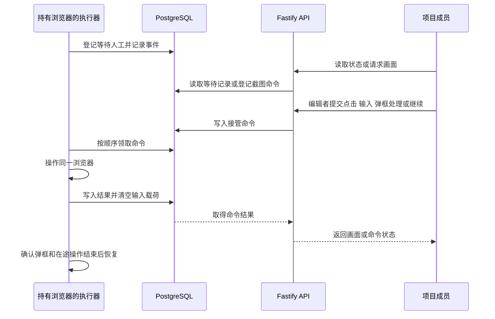

| 接管细节   | 实现                                                                                                                                                                                                                                                                                                         |
| ---------- | ------------------------------------------------------------------------------------------------------------------------------------------------------------------------------------------------------------------------------------------------------------------------------------------------------------ |
| 监听       | `watchElement` 约每 250 ms 检测可见性边沿，注册后立即检查；持续可见时不会反复请求。`watchDialog`、`watchResponse` 订阅 Playwright 事件，处理中同一监听器抑制重复请求，结束后继续监听                                                                                                                         |
| 阻塞点     | 步骤前后检查监听并等待接管队列，流程末尾检查并清理。触发时已发出的操作可能继续完成，操作自己的超时也仍有效。接管期间暂停运行总计时，心跳和取消仍有效                                                                                                                                                         |
| API        | `GET /api/runs/:rid/intervention` 给成员返回 `{active, info}`；`GET /api/runs/:rid/intervention/screenshot` 通过命令取同一页 PNG；编辑者 `POST /api/runs/:rid/intervention/actions` 提交 `click {x,y}`、`type {text}`、`press {key}`、`scroll {deltaY}`、`dialogAccept {text?}`、`dialogDismiss` 或 `resume` |
| 命令调度   | `run_interventions` 保存状态，`intervention_commands` 保存短时命令。执行器空闲时约每 200 ms 检查，API 约每 150 ms 等结果，上限 30 秒。活跃接管不存在或命令拒绝返回 `409`，等待超时返回 `504`。已经领取的命令可能继续执行，重试前核对现场                                                                     |
| 控制与收尾 | 普通操作同一时间只处理一项，弹框确认/取消可先解除阻塞。弹框未处理或普通操作仍在途时拒绝 `resume`。命令完成清空 `action`，输入文本与弹框回复不进入运行事件；取消或异常收尾时清除接管状态并终止未完成命令                                                                                                      |

实时预览在 [`preview.ts`](../src/server/preview.ts) 和 [`BrowserPreview.tsx`](../web/src/admin/BrowserPreview.tsx) 实现。展开面板且页面可见时，前端每次请求结束约 600 ms 后拉取 `GET /api/runs/:rid/preview`，关闭面板、切后台或结束时停止。请求刷新 `run_previews.requested_at`，执行器约每 500 ms 检查 3 秒观看租约，租约有效才截 JPEG 视口图（质量 55），过期清理。以图像和脱敏元数据计算 `ETag`，相同画面返回 `304`；`204` 通过 `X-Preview-State` 告知等待、弹框或结束。成功响应携带 `X-Preview-Meta`，包含阶段 `investigation`、`replay` 或 `jira`、路径、尺寸、最近动作、采集时间与短时点击点。界面叠加同页、1.5 秒内的可信点击位置。

预览只存最后一帧，减少录像成本和长期留存。预览截图遮罩密码框及执行器识别为填入环境凭据的字段；普通报告和接管截图遮罩密码框。画面、站点路径与业务数据受项目权限保护，文本脱敏与字段遮罩只覆盖已知凭据和已识别字段。接管状态、命令与预览通过数据库传递，前端所在实例可以不同于持有浏览器的执行器。执行器退出后的回收见运行调度章节。接管实现见 [`intervention.ts`](../src/server/intervention.ts) 与 [`Intervention.tsx`](../web/src/admin/Intervention.tsx)。

<a name="suites"></a>

## 9. 测试组

测试组把同一项目、同一环境的流程组成有序清单，数据与 API 位于 [`suites.ts`](../src/server/suites.ts)。流程的分类标签可用于筛选和编排，保存测试组时以明确的流程 ID 顺序为准。

| 分类键       | 工作台含义       |
| ------------ | ---------------- |
| `health`     | 健康检查         |
| `full`       | 全量检查         |
| `feature`    | 功能检查，默认值 |
| `one_off`    | 一次性检查       |
| `regression` | 回归检查         |

`test_suites.flow_ids` 最多 100 项。保存时校验每个流程属于当前项目和环境；允许先保存空测试组，启动前至少需一项。分类可通过 `PATCH /api/projects/:pid/flows/:fid/category` 修改。复制环境时在事务内重映射流程 ID 并保留测试组顺序。组编辑或删除不修改已经创建的运行批次，删除原组时历史 `suite_id` 置空。

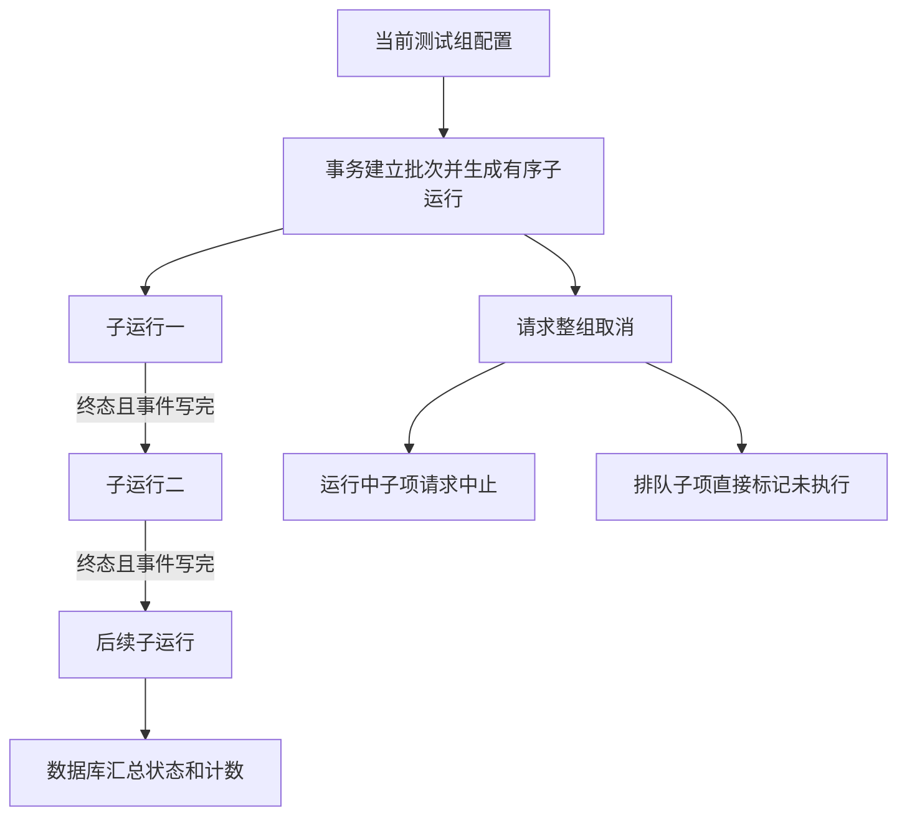

发起批次时锁定测试组并读取当时的清单，写入 `suite_runs`，为每项创建普通 `execute` 运行并保留当时的组名、项名、用例名和从 1 开始的顺序。每个子项使用新浏览器，浏览器状态不会在子项间传递。执行器领取时要求同批所有前序项都进入终态且 `events_complete=true`。单项断言失败后后续项仍可执行，人工接管中的子项会阻塞后续项。批次外的任务按共享队列调度规则处理。

| 批次状态    | 按优先级判定                                                   |
| ----------- | -------------------------------------------------------------- |
| `running`   | 有运行中项，或无排队项但有未收尾事件，或已有终态项且仍有排队项 |
| `queued`    | 还有排队项且未命中 `running`                                   |
| `cancelled` | 已无未收尾任务，批次被请求取消或有子项已取消                   |
| `failed`    | 无取消条件且有失败项                                           |
| `passed`    | 其余情况，正常完成的批次全部通过                               |

状态与通过、失败、取消、排队、运行中数量由查询聚合计算。开始时间取最早子项开始时间，完成时间仅在全部终态且事件写完后取最晚完成时间。取消接口在事务中标记组和活动项，排队项立即成为 `cancelled`、`events_complete=true`，记录「未执行（测试组已取消）」；正在运行的项由执行器中止，已完成项保留。再次从测试组入口运行会创建新批次，使用此时的清单。可在普通流程入口重放某个失败项；组内自动重试或只重跑失败项的接口当前未提供。

| API                                                 | 权限与语义                                                           |
| --------------------------------------------------- | -------------------------------------------------------------------- |
| `GET /api/projects/:pid/suites?environmentId=…`     | 项目成员读取指定环境组及按清单顺序展开的流程                         |
| `POST /api/projects/:pid/suites`                    | 编辑者创建。输入 `environmentId`, `name`, `description?`, `flowIds?` |
| `PUT` / `DELETE /api/projects/:pid/suites/:sid`     | 编辑者更新或删除指定环境的组；更新替换名称、说明与有序 ID            |
| `POST /api/projects/:pid/suites/:sid/runs`          | 编辑者创建批次，返回批次 ID                                          |
| `GET /api/projects/:pid/suite-runs?environmentId=…` | 项目成员读取环境最近 100 批次                                        |
| `GET /api/suite-runs/:id`                           | 项目成员读取汇总、进度及有序子项                                     |
| `POST /api/suite-runs/:id/cancel`                   | 编辑者请求整组取消                                                   |

[`TestSuites.tsx`](../web/src/admin/TestSuites.tsx) 支持选择流程和调整顺序，活动批次列表约每 2.5 秒更新。[`SuiteRunDetail.tsx`](../web/src/admin/SuiteRunDetail.tsx) 的活动批次报告约每 1.5 秒更新，展示总进度、单项错误和运行报告链接。等待人工处理时可进入对应单项，尚未开始即取消的子项标为「未执行」。

<a name="jira"></a>

## 10. Jira 集成

### 10.1 分阶段入口与数据流

Jira 集成通过 Playwright 执行网页操作。外部 Agent 当前在模拟 Jira 和模拟登录页验收，内网 Agent 在可访问真实站点的机器完成接入。每条对话绑定接收消息实例的本机执行器标识，浏览器和登录状态留在该机器。PostgreSQL 共享需求快照、用例、流程、运行证据和回写记录。Jira 使用浏览器现场的登录状态与访问权限。 [Jira 站点接入](#handoff-jira)

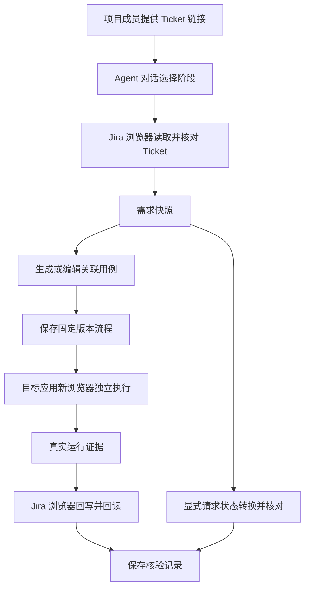

[`Jira.tsx`](../web/src/admin/Jira.tsx) 的项目页显示快照、关联用例、站点配置与回写记录，阶段入口创建绑定当前环境的会话，并把请求放入可编辑的 `sessionStorage` 草稿，用户发送后才执行。各阶段可以在完成后停止，其他成员可使用同一项目资产继续。单纯读取只保存快照；仅保存流程和普通聊天完成没有测试结果。执行候选按当前关联用例筛选并提示旧版本；回写候选按运行快照中的 Jira 关联筛选。

| 阶段         | Agent 工具                                                                                 | 约定                                                                                                               |
| ------------ | ------------------------------------------------------------------------------------------ | ------------------------------------------------------------------------------------------------------------------ |
| 查找快照     | `list_jira_issues {search?, offset?}`                                                      | 在当前项目按标题、编号或 URL 查找，每页 30 条                                                                      |
| 读需求       | `jira_read_issue {url}`                                                                    | 打开真实 Ticket，读标题、描述、验收条件、评论和状态；同项目、origin、Ticket key 覆盖同一快照，返回 `missingFields` |
| 用例         | `list_test_cases`、`read_test_case`、`save_test_case`                                      | 读写项目用例，关联 `jiraIssueId`，Agent 更新时提供读取到的 `expectedVersion`。先判断实际需求信息是否足够           |
| 编排         | `list_nodes`、`save_node`、`save_flow`                                                     | 调查目标应用，复用节点并固定 `caseId`/`caseVersion`。仅保存阶段可独立完成                                          |
| 执行         | `list_flows {caseId?, offset?}`、`run_flow {flowId}`                                       | 查找本环境流程并运行指定流程，产生独立子运行 ID、真实状态、汇总与截图                                              |
| 读证据       | `list_project_runs {caseId?, flowId?, offset?}`、`read_run {id}`                           | 当前项目跨对话查询。列表每页 30 条，单次读取包含最多 40 条相关执行事件和 30 项产物元数据                           |
| 回写         | `jira_publish_result {issueId, runId}`                                                     | 明确请求后由运行证据生成评论，提交并回读。返回 `publicationId` 和 `alreadyPublished` 等结果                        |
| 转状态       | `jira_transition {issueId, status, transitionLabel?}`                                      | 选择页面可用的转换项并核对目标状态；有歧义时先确认目标                                                             |
| 修复站点定位 | `jira_inspect {url}`、`jira_investigate {url, step}`、`save_jira_adapter {url, selectors}` | 先读页面和适配器，调查动作限于 `click`、`press`、`waitFor`，保存部分选择器覆盖后重新开启站点浏览器                 |

编排、执行和回写连用时走 `save_flow → run_flow → jira_publish_result`，让 Agent 在子运行结束后继续读取证据。`finish_flow` 用于编排结束后立即独立回放。用例和流程版本规则见第 3、8 节。Jira 阶段工具见 [`jira-tools.ts`](../src/server/jira-tools.ts)。

| 管理 API                                                                                    | 数据和权限                                                                                                                     |
| ------------------------------------------------------------------------------------------- | ------------------------------------------------------------------------------------------------------------------------------ |
| `GET /api/projects/:pid/jira`                                                               | 项目成员读取最新 100 条 `issues`、与其关联的正式 `cases`、全部 `adapters`、最近 100 条 `publications` 和 `defaultScript`       |
| `PUT /api/projects/:pid/jira/sites`                                                         | 编辑者保存 `{origin, script, allowedOrigins?}`。顶层 `allowedOrigins` 提供时覆盖脚本对应值。按项目和 origin 保存当前修订和历史 |
| `POST /api/projects/:pid/cases`、`PUT /api/projects/:pid/cases/:cid`                        | 创建或更新测试用例，支持 `jiraIssueId`；编辑传 `expectedVersion` 检查版本冲突                                                  |
| `GET /api/projects/:pid/cases/:cid?version=N`、`GET /api/projects/:pid/cases/:cid/versions` | 读取指定或当前版本，或读取按版本倒序的历史                                                                                     |

### 10.2 站点适配、登录现场与隔离

[`integrations/jira.ts`](../src/integrations/jira.ts) 实现 `JiraBrowser`。链接须为无内嵌凭据的 HTTP(S) URL，支持 `/browse/KEY-123` 或 `selectedIssue=KEY-123`，编号转大写并移除 URL fragment。适配器是带 `schemaVersion: 1` 的 JSON，选择器长度不超过 1,000。默认规则覆盖部分常见 Jira 页面结构。`jiraSite` 按项目和 origin 选择最新规则，内容相同重复保存复用现有修订，变化时在同一事务写当前与历史版本。

| 选择器组   | 字段                                                       |
| ---------- | ---------------------------------------------------------- |
| 身份与访问 | `issueKey`, `login`, `denied`                              |
| 需求字段   | `title`, `description`, `acceptanceCriteria`, `status`     |
| 评论读取   | `comments`, `commentsOpen`                                 |
| 评论提交   | `commentOpen`, `commentInput`, `commentSubmit`             |
| 状态操作   | `statusOpen`, `statusOptions`, `statusConfirm`             |
| 补充导航   | `allowedOrigins` 最多 10 个完整 HTTP(S) origin，值不带路径 |

Jira 浏览器与被测应用浏览器分别启动，切换目标或修订时关闭旧现场。Jira 会话没有被测环境的凭据和变量。该会话允许浏览器发起跨 origin 的 HTTP(S) 顶层导航，并跟踪登录新窗口，显式 DSL 导航仍检查目标 origin 或适配器允许列表，跨域内嵌登录框需配置对应 origin。业务读写的 `ensureTicket` 每次检查原站点、页面显示的 Ticket key 和登录/拒绝提示。出现登录表单、已配置的认证元素或登录跳转时用第 8 节的人工接管，用户继续后返回主窗口并再次访问原 Ticket；仍需登录则重新请求，拒绝访问或编号不符则报错。成功核对后保存本机 Playwright `storageState`，目录为 `.data/jira-sessions/<用户 ID>/<项目 ID>/`，文件名为 Jira origin 的 SHA-256 加 `.json`，临时文件权限 `0600` 后原子重命名。换用户、项目、站点或本机目录会有独立登录状态。预览和接管入口仍执行项目成员权限校验。

字段采集各截取最多 60,000 字符，标题必需。缺失描述、验收条件或状态会在工具返回中标记，评论为空是允许的。选择器失效时先用 `jira_inspect` 读页面和当前配置，必要时调查菜单，确认后只更新相关选择器，随后重试对应阶段。页面文字是输入资料，发布和转状态由当前用户的请求授权。内网部署的页面结构、富文本编辑器和工作流差异由站点适配承接。

### 10.3 回写核验与重复提交

[`jira.ts`](../src/server/jira.ts) 先校验 Ticket 和运行属于同一项目，运行必须已结束、`events_complete=true`、状态为 `passed`、`failed` 或 `cancelled`，并持有实际执行快照。快照中的用例版本必须关联选定 Ticket。当前用例之后修改或解除关联，不改变已有结果的历史归属。评论正文从快照和运行结果生成，包含用例及版本、流程、环境、完成时间、状态、汇总、错误与最多五条失败步骤，整体限制 16,000 字符。Agent 不传入自由编写的测试结果。

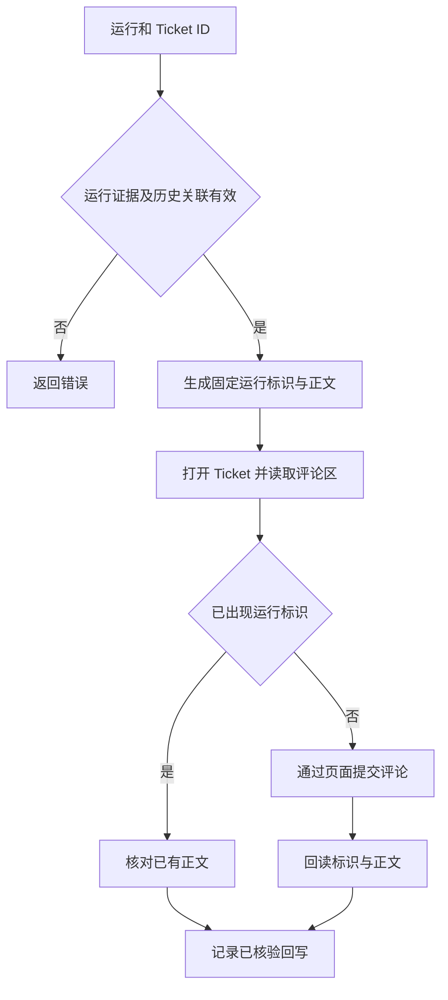

去重基于可读评论区域中的稳定标识 `[LoopLab run <运行 ID>]`。已有标识时仍校验正文，成功返回 `alreadyPublished`，无需再次提交评论。评论提交后须回读标识和正文，登录失效时走重新接管及 Ticket 核对。标识检测的覆盖范围取决于站点适配能读取的评论；评论分页、折叠和加载方式需现场确认。外部评论与本地数据库记录分步完成，重试时先读页面核对已提交结果。回写核验成功后插入 `jira_publications` 并发 `jira_published`，重复核验可再留下本地记录。

状态操作读取当前状态，已达到目标时返回 `changed: false`；否则在可见转换菜单按实际文字精确匹配 `transitionLabel` 或目标状态，处理可见的确认控件，并回读状态文本。成功后更新快照状态、写入 `jira_publications` 并发 `jira_transitioned`。写入与核验由独立的站点脚本承担。被测应用流程导出只包含测试 DSL，Jira 操作需平台执行；结果回写目前是文字，附件上传和任意富文本编辑器未提供专用工具。

外部验收使用本地模拟站点，真实内网验收由内网 Agent 接力。 [本地夹具](#verification) · [Jira 站点接入](#handoff-jira)

<a name="worker"></a>

## 11. 任务执行与调度

`main.ts` 在数据库迁移与 HTTP 监听成功后启动 Worker。HTTP 请求负责校验和入队，Worker 负责后续模型、浏览器、人工接管和证据写入。浏览器页面刷新或关闭连接后，可以按运行 ID 继续查看后台任务。调度入口在 [worker.ts](../src/server/worker.ts)，执行器标识在 [executor.ts](../src/server/executor.ts)。

### 11.1 入队与执行路径

| 入口                                          | 持久化记录                                  | Agent 与回放行为                                             | 领取方式                 |
| --------------------------------------------- | ------------------------------------------- | ------------------------------------------------------------ | ------------------------ |
| 对话发送消息                                  | 在事务内创建 `runs`、用户消息及助手占位消息 | 加载会话及项目上下文。可以回复、调查、保存资产，或生成并回放 | 绑定接收请求的本机执行器 |
| 普通生成或修复 `POST /api/projects/:pid/runs` | `generate` 或 `repair` 运行                 | 调查真实页面，保存流程后以新浏览器回放                       | 共享队列                 |
| 直接回放 `POST /api/projects/:pid/runs`       | `execute` 运行，固定 `flow_id`              | 解析节点和用例版本后独立执行                                 | 共享队列                 |
| 测试组运行                                    | 批次和带顺序的多条 `execute` 运行           | 每个流程独立执行，组内按顺序领取                             | 共享队列，受前序运行约束 |
| Agent 的 `run_flow`                           | 带 `parent_run_id`、立即标记运行中的子运行  | 在同一个调用内运行已保存流程，将结果返回父对话               | 当前 Worker 直接执行     |

每次领取先清理租约失效任务，再按 `created_at, suite_position` 选取符合范围的队列记录。SQL 以 `FOR UPDATE OF r SKIP LOCKED` 取得候选行，并在同一语句中填入 `worker_id`、开始时间和首个心跳。一个服务实例串行领取队列任务。多实例共享 PostgreSQL 时，组内前序记录仍须终止且写完事件，独立任务可由不同实例领取。

`worker_id` 是进程启动时生成的 UUID，标识一次 Worker 生命周期。`executor_id` 由主机名和工作目录的绝对路径计算 SHA-256。聊天只由相同 `executor_id` 的进程领取，因此本地 Jira 登录状态和个人记忆与执行位置一致。未绑定 `executor_id` 的运行可被任意实例领取，部署时应使它们都能访问目标地址。

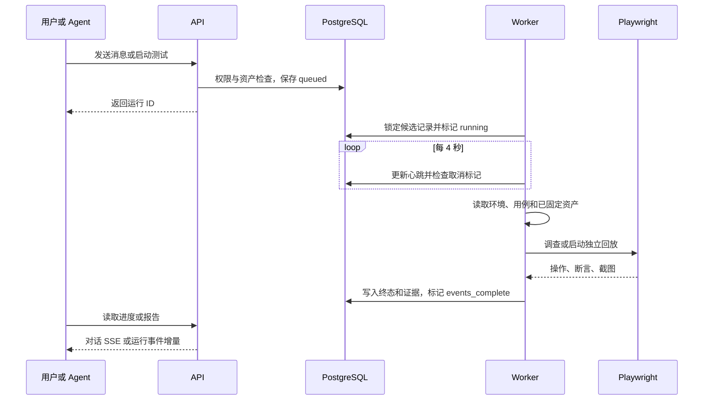

子运行与父对话使用独立的运行 ID、状态和证据。子运行执行时暂停父对话总计时，子运行有自己的计时器与心跳。父对话取消会中止子运行。预览和人工接管在父对话 ID 下呈现，子运行结束后，Agent 可依据真实结果汇报、进一步调查或请求 Jira 回写。直接执行子运行使父任务在同一个 Worker 上就能拿到结果。

### 11.2 状态、超时与取消

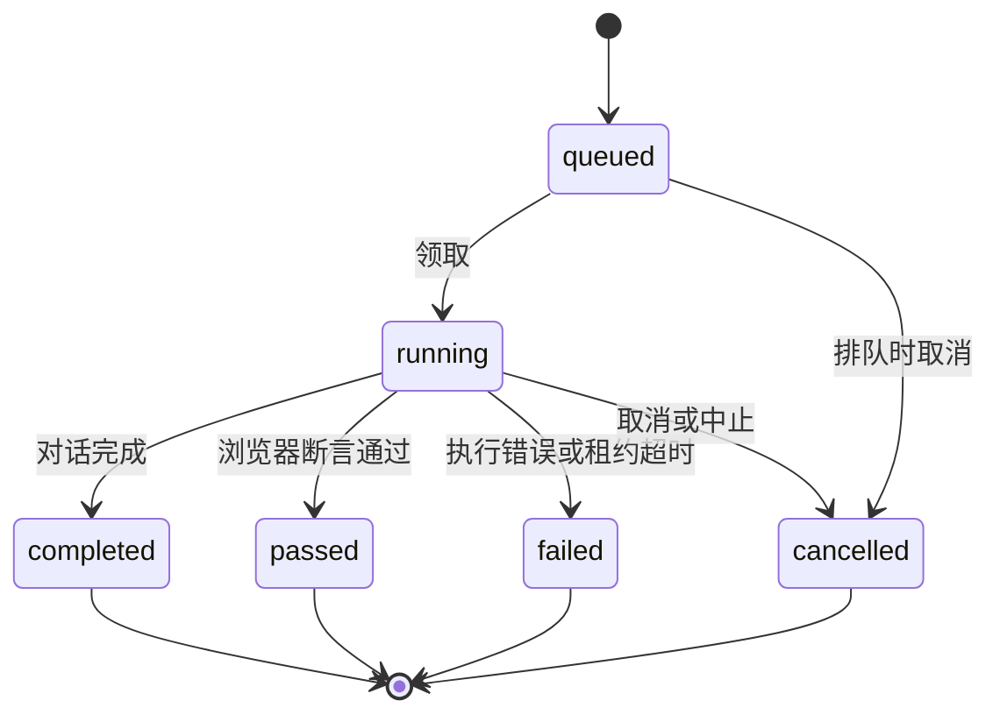

| 机制     | 执行语义                                                                                                                              |
| -------- | ------------------------------------------------------------------------------------------------------------------------------------- |
| 空闲轮询 | 一轮领取处理结束后间隔 1 秒继续。发送聊天消息可唤醒空闲 Worker                                                                        |
| 运行心跳 | 每 4 秒更新一次，同时读取 `cancel_requested`。租约不再属于本 Worker 或心跳写入失败时中止当前执行                                      |
| 租约回收 | 领取循环将心跳超过 60 秒的运行置为失败，已请求取消的置为取消。清除预览、接管现场并使未完成命令失败                                    |
| 总超时   | 默认 600,000 ms，从执行开始计时。人工接管期间暂停总计时，恢复时使用剩余预算。浏览器操作仍有各自的超时                                 |
| 停止运行 | `POST /api/runs/:rid/cancel` 写入取消标记。排队任务立即完成取消，执行中由持有者观察标记并中止。持有任务的本地进程也可立即触发中止信号 |
| 完成标记 | 终态与 `events_complete` 分开。清理浏览器及预览后置完成标记。领取循环也补齐结束超过 60 秒但标记未写完的任务                           |
| 退出服务 | SIGINT 或 SIGTERM 停止领取并中止当前任务，等待执行清理后关闭 HTTP 与数据库池                                                          |
| 恢复工作 | 进程异常结束后按租约回收。用户可发起新回放或针对失败节点修复，原运行保留作为证据                                                      |

`completed` 表示 Agent 已完成对话请求。`passed` 表示已经执行固定流程且断言通过。保存节点、保存流程、用户看到助手回答都各自有独立事件。运行失败或取消后，已保存的资产可继续使用。

### 11.3 证据与报告

| 内容      | 生成与读取                                                                                                                                          |
| --------- | --------------------------------------------------------------------------------------------------------------------------------------------------- |
| 运行快照  | 回放前保存流程、环境 ID／名称／URL／变量、执行用例与解析出的节点版本和参数。环境凭据使用占位符，快照写入前对已知环境秘密脱敏                        |
| 步骤事件  | `run_events` 记录运行阶段、工具调用、节点开始和通过、步骤开始／通过／失败、接管及终态。事件 ID 用于游标                                             |
| 最终截图  | 成功写入 `final.png`。浏览器已打开且未被中止时，失败路径尝试写入 `failure.png`。节点也可以主动截图                                                  |
| 查询      | `GET /api/runs/:rid` 返回运行、附件索引和事件。以 `after` 递增读取，普通请求最多 10,000 条。使用 `incremental=true` 时每批 250 条，运行摘要省略快照 |
| 下载      | `GET /api/artifacts/:aid` 通过运行所属项目校验成员权限，返回相应 MIME 的附件及 `private, no-store`                                                  |
| Jira 证据 | 回写工具以终态、事件完整、带流程快照及运行时用例关联为依据，生成报告评论并从 Jira 页面核验                                                          |

模型任务的 `run_started` 记录模型名及 `llmRevision`。日志脱敏使用本轮模型 API Key 和当前环境的已知秘密。截图对密码字段遮罩，浏览器预览还遮罩已登记的秘密输入。业务页面、用户消息与附件的内容按项目权限保存，个人记忆工具正文单独留在账号 Git 仓库与模型上下文。详见[存储与数据模型](#data)和[项目知识与个人记忆](#memory)。

<a name="operations"></a>

## 12. 配置与部署

### 12.1 启动配置与数据库配置

需要 Node.js 22+、npm、可访问的 PostgreSQL、Playwright Chromium 或已安装的 Chrome。个人记忆需要服务进程可执行 `git` 并可写记忆目录。浏览器和 Jira 网络访问由执行器所在机器提供。依赖版本见 [package-lock.json](../package-lock.json)，启动配置见 [config.ts](../src/server/config.ts) 和 [.env.example](../.env.example)。

安装者只需配置 `DATABASE_URL`。环境变量优先于工作目录中的 `.env.local`。连接相同数据库的实例共享项目、运行证据和服务端配置，各自执行本地浏览器。管理员先初始化数据库 schema，再使用数据库维护权限配置模型。

| 配置                                       | 来源和使用时机                                                                                                                 |
| ------------------------------------------ | ------------------------------------------------------------------------------------------------------------------------------ |
| `DATABASE_URL`                             | 实例启动时从进程环境或 `.env.local` 读取，连接共享 PostgreSQL                                                                  |
| `app_secret`                               | 共享数据库 `qa.runtime_settings` 的初始化密钥，启动时读取，用于环境凭据加密与 cookie 签名。已有数据库升级时保留原 `APP_SECRET` |
| `llm_base_url`、`llm_api_key`、`llm_model` | 管理员在数据库中一起更新。每条需要模型的任务开始时读取一次，后续任务使用更新后的配置                                           |
| `HOST`、`PORT`                             | 本机监听，默认 `127.0.0.1:4310`，端口整数范围 1–65535                                                                          |
| `COOKIE_SECURE`                            | 值为 `true` 时设置安全 cookie，HTTPS 部署开启                                                                                  |
| `PLAYWRIGHT_CHANNEL`                       | 留空用 Playwright Chromium，设 `chrome` 使用安装的 Google Chrome                                                               |
| `RUN_TIMEOUT_MS`                           | 默认 600,000 ms，整数 1–2,147,483,647                                                                                          |
| `LOOPLAB_PERSONAL_MEMORY_DIR`              | 默认为工作目录下 `.data/personal-memory`，可配置持久化目录                                                                     |
| `DEMO_TARGET_ENABLED`                      | 值为 `true` 时启用验收用 `/demo` 页面和 API，默认关闭                                                                          |

### 12.2 管理员初始化与更新

数据库维护账号负责 schema 迁移与模型配置写入。首次建立 `qa.runtime_settings` 时，空数据库生成应用密钥。已有环境凭据的库使用原 `APP_SECRET` 完成初始化，再由每个实例从数据库读取同一个密钥。此前的 AI 环境变量可以导入初始记录。运行中的模型配置以数据库为准。

管理员在构建目录或分发包目录运行 `npm run db:migrate` 初始化 schema，再通过 `npm run configure:llm` 从标准输入提交 `{baseUrl, apiKey, model}`。也可用 `npm run configure:llm -- --from-env` 从本地进程变量、`.env.local` 或 `OPENAI_ENV_FILE` 导入现有配置。导入时分别取非空的进程变量、`.env.local`、`OPENAI_ENV_FILE`，地址和模型缺省值为 `https://api.openai.com/v1` 与 `gpt-6-luna`。一次写入同时更新三项和配置版本，管理命令只返回模型与版本信息。已有配置的数据库可继续从管理员连接执行该命令，无需分发新包。直接在数据库维护时也应在一条 SQL 或一个事务更新三项及版本，保留应用密钥。

```mermaid
sequenceDiagram
    participant A as 数据库管理员
    participant D as 共享 PostgreSQL
    participant W as 用户本机 Worker
    participant M as Responses API
    W->>D: 读取应用密钥并启动
    W->>D: 新任务读取 LLM 配置版本
    W->>M: 使用本轮地址、密钥和模型
    A->>D: 更新三项配置与版本
    W->>M: 本轮继续使用已读取的版本
    W->>D: 下一任务重新读取
    W->>M: 使用新的配置版本
```

已完成 schema 初始化后，实例可以用单独的运行角色启动。该角色对 `qa` 中的业务表具备运行所需的读写权限，对 `runtime_settings` 与 `schema_migrations` 只授予读取权限。管理员连接承担迁移和配置写入。直接连接数据库的执行器属于受信任的团队边界，其持有者可用该连接访问运行所需的数据和密钥。数据库配置及密钥只通过服务端读取，HTTP 会话与健康检查仅返回模型状态。

以下 SQL 用于已初始化 `qa` schema 的数据库。运行角色由管理员创建，需能连接该数据库，且与表的维护角色分开。后续迁移新建表时核对该角色的权限。

```sql
GRANT USAGE ON SCHEMA qa TO looplab_runtime;
GRANT SELECT, INSERT, UPDATE, DELETE ON ALL TABLES IN SCHEMA qa TO looplab_runtime;
GRANT USAGE, SELECT ON ALL SEQUENCES IN SCHEMA qa TO looplab_runtime;
REVOKE INSERT, UPDATE, DELETE ON qa.runtime_settings, qa.schema_migrations FROM looplab_runtime;
```

### 12.3 构建、打包与启动

| 运行方式         | 命令与配置                                                                                                                                        |
| ---------------- | ------------------------------------------------------------------------------------------------------------------------------------------------- |
| 源码安装         | `npm ci`，填入 `.env.local`，安装 Playwright Chromium 后 `npm run build`、`npm start`                                                             |
| 产出分发包       | `npm run package` 构建后端与前端，用 `tar` 生成 `.data/release/looplab-<版本>.tgz`。连接配置由管理员在分发时单独提供                              |
| 启动分发包       | 解包到空目录，在目录内 `npm ci --omit=dev`，配置 `DATABASE_URL`，执行 `npx playwright install chromium` 或选择已安装的 Chrome，再执行 `npm start` |
| 本地数据库初始化 | 在尚未创建 `.env.local` 的源码目录执行 `npm run setup:local -- <postgres-container-name>`，新建角色与数据库并生成连接配置                         |
| 本地开发         | `npm run dev` 与 `npm run dev:web`，Vite 监听 4311，代理 `/api` 与 `/demo/api` 到 4310                                                            |
| 多个本地执行器   | 使用同一 PostgreSQL。各机器的环境地址应能被可能领取任务的执行器访问。聊天固定由接收请求的本机执行器处理                                           |
| HTTPS 服务       | 按网络范围设置 `HOST`，反向代理提供 HTTPS，配置 `COOKIE_SECURE=true` 并保持 SSE 流式传输                                                          |
| 持久数据         | PostgreSQL 保存团队资产、配置及证据，本机目录保存个人记忆和 Jira 浏览器会话，分别备份                                                             |

`npm run build` 输出 `dist/` 与 `web-dist/`，并预生成 Brotli 和 gzip。Fastify 提供静态资源与 SPA 入口，哈希 assets 使用一年 immutable 缓存，HTML 重新验证，未知 API 和 assets 请求返回 404。运行包包含构建结果、运行命令、锁定依赖和配置模板。数据库连接串、LLM 密钥、浏览器会话、个人记忆和本地验收产物通过独立配置与数据目录管理。

启动检查 schema 并读取应用密钥，随后开始监听和领取任务。默认地址为 `http://127.0.0.1:4310`。`GET /api/health` 可查看数据库与模型配置状态，`npm run check:llm` 验证当前数据库中的真实 Responses 配置，源码环境也可用 `npm run test:live`。未配置模型时可登录、管理资产和直接回放，模型任务给出配置提示。

<a name="verification"></a>

## 13. 端到端验收

LoopLab 使用两类目标。内置 `/demo` 提供可控的登录和对话站点，用于验证从自然语言目标到真实断言回放的闭环。独立 LoopLab 目标实例用于自举，工作台通过自己的浏览器、流程和 Agent 验证另一个实例。新功能的行为检查写进对应的端到端验收；类型检查和构建验证可编译性。

```mermaid
flowchart TB
    Script["验收脚本"] --> Control["工作台实例 · 4310"]
    Control --> ControlDB[("工作台数据库")]
    Control --> Browser["工作台执行浏览器"]
    Browser -->|"真实 UI 操作与断言"| Target["目标 LoopLab · 4312"]
    Target --> TargetDB[("隔离目标数据库")]
    Target -->|"对话用例需要时"| Model["真实 Responses API"]
    Control --> Report["运行报告 · 步骤 · 截图"]
    Script --> Result[("本地验收结果 JSON")]
```

### 13.1 准备验收环境

1. 在可清理的测试数据库上启动工作台。跑 `/demo` 用例时设置 `DEMO_TARGET_ENABLED=true`。
2. 自举另启一个服务实例，配置独立数据库，例如 `looplab_selftest`，默认目标端口 `4312`。两个实例可共用 PostgreSQL 服务。个人记忆验收为目标配置独立的 `LOOPLAB_PERSONAL_MEMORY_DIR`，例如 `.data/selftest-personal-memory`。
3. 为需登录工作台的脚本准备 `.data/acceptance-credentials.json`。最小结构是 `{"owner":{"email":"…","password":"…"}}`，也可复用 `test:acceptance` 生成的凭据文件。将文件留在被忽略目录并限制权限。
4. 支持覆盖的脚本使用 `SELF_TEST_TARGET_URL` 指定被测服务，`SELF_TEST_OWNER_FILE` 指定工作台凭据文件。工作台基址来自配置的 `PORT`。手动同时打开两个实例时使用独立浏览器上下文，因为相同主机下两个端口共享 cookie 名称。
5. 按下表选择验收入口。真实模型脚本使用当前 Responses 配置，生成流程和目标聊天均可能产生模型请求。验收通过以脚本退出状态、实际运行状态与断言为准。

内置 Demo 的 `POST /demo/api/login` 核对固定测试账号并设置签名 `demo_session`，`GET /demo/api/me` 返回登录状态。登录后，`POST /demo/api/message` 接收最多 2,000 字符的消息，返回包含原消息和系统状态的回显，作为浏览器断言的目标。 [app.ts](../src/server/app.ts) · [demo.tsx](../web/src/demo.tsx)

### 13.2 验收命令与证据

| 命令                                           | 验收范围与先决条件                                                                                                           | 结果位置                                                               |
| ---------------------------------------------- | ---------------------------------------------------------------------------------------------------------------------------- | ---------------------------------------------------------------------- |
| `npm run typecheck`、`npm run build`           | 前后端类型检查和生产构建                                                                                                     | 进程退出状态，`dist/`、`web-dist/`                                     |
| `npm run test:live`                            | 配置真实模型，调用 echo 工具并将结果回填                                                                                     | JSON 控制台结果                                                        |
| `npm run test:acceptance`                      | 启用 `/demo`。验证权限、真实模型编排、节点复用、多环境、错误选择器、局部修复与浏览器回放                                     | `.data/acceptance-result.json`、本地截图和运行报告                     |
| `npm run verify:export`                        | 使用验收通过的流程和环境，执行导出的独立 TypeScript/Playwright 脚本                                                          | `.data/exported-flow.ts`、执行输出                                     |
| `npm run verify:collaboration`                 | 使用验收结果与账号，自动另起同库服务实例验证共享队列、复用与取消，确保 4312 可用                                             | 控制台结果和数据库运行记录                                             |
| `npm run verify:management`                    | 启用 `/demo`。验证项目环境管理、表单权限、归档、分页、游标、静态资源、响应式布局与浏览器回放                                 | `.data/management-result.json`                                         |
| `npm run verify:chat`                          | 启用 `/demo`，复用验收凭据。验证附件、真实模型、多轮编排、SSE、幂等、协作、取消与移动端                                      | `.data/chat-acceptance-result.json`、`.data/screenshots/chat/`         |
| `npm run verify:self`                          | 双实例。在目标准备账户和资产，由工作台生成测试，验证登录和资产浏览，再做独立复跑                                             | `.data/self-test-result.json`                                          |
| `npm run verify:self-chat`                     | 使用基础自举结果，验证目标聊天的即时问答、多轮上下文、刷新和外层节点复用                                                     | `.data/self-test-chat-result.json`                                     |
| `npm run verify:self-knowledge`                | 项目知识的自动加载、分页、对话写入、更新、跨环境和项目隔离                                                                   | `.data/self-test-knowledge-result.json`                                |
| `npm run verify:self-memory`                   | 跨项目偏好、同项目账号隔离、账号页面保存、CAS 冲突、清空及 Git 版本。用 `SELF_TEST_TARGET_MEMORY_DIR` 指向目标记忆目录       | `.data/self-test-memory-result.json`、记忆仓库、截图                   |
| `npm run verify:self-preview`                  | 延迟真实发送响应以观察即时反馈，检查真实点击帧、关闭停止取帧和权限                                                           | `.data/self-test-preview-result.json`                                  |
| `npx tsx scripts/verify-self-files.ts`         | 文件库权限、字节一致性、上传节点、文本驱动流程、归档引用、导出和模型读取，截图理解使用[验收 PNG 夹具](images/agent-chat.png) | `.data/self-test-files-result.json`                                    |
| `npx tsx scripts/verify-self-intervention.ts`  | 本地临时网页的元素、网络和弹框监听，浏览器接管、重复触发、继续与停止                                                         | `.data/self-test-intervention-result.json`                             |
| `npx tsx scripts/verify-self-suites.ts`        | 测试组顺序、失败后继续、汇总、环境隔离和复制                                                                                 | `.data/self-test-suites-result.json`                                   |
| `npx tsx scripts/verify-self-suites-cancel.ts` | 取消运行中的测试组，检查未执行项和后续调度                                                                                   | `.data/self-test-suites-cancel-result.json`                            |
| `npm run verify:self-jira`                     | 双实例及模拟 Jira，验证登录接管、分阶段工作流、回写核验和选择器修复                                                          | `.data/self-test-jira-result.json`、`.data/jira-login-N.png`、运行报告 |
| `npx tsx scripts/verify-self-jira-evidence.ts` | 主 Jira 验收后的同一隔离环境。修改当前用例为解除 Jira 关联的 v3，验证旧流程仍执行 v2、拒绝发布普通对话和 Ticket URL 去重     | `.data/self-test-jira-evidence-result.json`                            |

基础自举通过后，可运行 `npm run verify:self -- --replay` 或 `npm run verify:self-chat -- --replay`，重放本地结果文件记录的流程。目标聊天仍会向模型发请求。查看失败任务的运行报告时，先定位失败步骤和页面，再从共享节点发起修复并重新验证。隔离的目标数据支持反复生成或重复执行会写入目标站点的用例。

### 13.3 双实例共享配置验收

将两份服务分别启动在 `4320` 和 `4321`，使用不同工作目录和同一个隔离数据库。数据库名使用 `looplab_shared_test` 或带下划线后缀的名称。用管理员数据库连接运行下列脚本，并将 `SELF_TEST_SHARED_DATABASE` 指向实际隔离库名。也可用 `SELF_TEST_SHARED_FIRST_URL` 与 `SELF_TEST_SHARED_SECOND_URL` 指定两处不同的本地 HTTP 地址。

```bash
SELF_TEST_SHARED_DATABASE=looplab_shared_test npx tsx scripts/verify-shared-settings.ts
```

脚本核对账号、项目和环境凭据跨实例共享，通过两处测试 Responses 地址验证三项配置动态切换，进行中的工具续轮使用原版本。结果位于 `.data/shared-settings-result.json`。

### 13.4 Jira 模拟站点与场内验收

| 本地端点                     | 夹具约定                                                                    |
| ---------------------------- | --------------------------------------------------------------------------- |
| `/browse/DEMO-1`             | 提供 Ticket、标题、Story、验收条件、评论和状态转换，支持登录后返回原 Ticket |
| `/app`                       | 提供待测试的 Echo 消息输入、发送和回显，用于生成并执行真实流程              |
| `/control?reset&sso=true`    | 重置测试数据并启用跨 origin 登录。默认 Jira 在 4314，登录页在 4315          |
| `/control?expireSubmit`      | 模拟评论提交后会话过期，触发重新接管与回读核验                              |
| `/control?changedTitle=true` | 改变标题元素定位，用于站点脚本修复                                          |
| `/control`                   | 读取夹具的评论与状态，供验收断言核对                                        |

主验收从 `SELF_TEST_JIRA_FIXTURE_URL` 读取夹具基址，默认 `http://127.0.0.1:4314`。临时服务源文件及夹具数据放在 `.data/jira-fixture/`。补充证据脚本使用主验收的目标账号与结果，分别由 `SELF_TEST_JIRA_CREDENTIALS_FILE` 和 `SELF_TEST_JIRA_RESULT_FILE` 指定，默认读取 `.data/jira-fixture/target-credentials.json` 与 `.data/self-test-jira-result.json`。重新做 v2 到 v3 的证据检查前，先运行主验收准备对应数据。

模拟站点负责复现登录、页面改动和结果回读。内网 Agent 按[站点接入与验收顺序](#handoff-jira)在可访问真实 Jira 的执行器上验证。

### 13.5 故障注入与构建检查

| 故障           | 验收动作                                                              | 预期证据                                         |
| -------------- | --------------------------------------------------------------------- | ------------------------------------------------ |
| AI 地址不可达  | 在独立实例将隔离库的 LLM 地址改为不可达地址，执行需要模型的生成或对话 | 运行失败或对话显示模型错误，脚本按实际终态退出   |
| 数据库不可达   | 令测试实例指向不可达的 `DATABASE_URL` 并启动                          | 初始化失败，日志提示连接或迁移                   |
| 目标站点不可达 | 使用独立环境地址或自举目标地址测试                                    | 导航或自举失败，运行事件记录错误                 |
| 选择器错误     | 以测试数据生成错误节点版本或 Jira 适配器                              | 报告定位失败步骤，从页面调查修复，再以新版本回放 |
| 版本竞争       | 用旧用例版本或个人记忆 SHA 提交修改                                   | 读取到冲突，最新记录保持完整                     |
| 人工接管与取消 | 在接管或队列等待时请求继续、取消                                      | 接管和取消事件、最后状态及测试组汇总一致         |

保留 `test/` 下的既有行为测试和 `npm test` 入口。新增及回归验收使用平台端到端脚本。构建模板位于 [ci-workflow.template.yml](ci-workflow.template.yml)，可用于 Node.js 24 的 `npm ci` 与生产构建。真实模型与浏览器验收按上述方式配置目标实例和凭据。

<a name="tradeoffs"></a>

## 14. 设计取舍

| 设计选择                                      | 收益                                                     | 运行代价或约束                                                                      |
| --------------------------------------------- | -------------------------------------------------------- | ----------------------------------------------------------------------------------- |
| 同一 Node 服务托管 API 与 Worker              | 本地启动简单，HTTP 和执行共享配置                        | 每实例串行领取。多实例通过数据库分担，聊天有执行器绑定                              |
| PostgreSQL 同时保存业务数据、队列、事件和附件 | 权限、版本、执行证据和入队可在共享数据库中查询或事务更新 | 心跳和帧轮询产生数据库请求，截图与文件占用存储。按部署规模管理连接和容量            |
| Agent 编排，固定 DSL 独立回放                 | 第一次探索利用模型，后续执行按固定节点和参数复用         | 生成受实际页面和模型输出影响。顺序节点适合 DOM 操作与断言，复杂分支由调用方拆分流程 |
| 环境级节点版本及用例版本固定                  | 可比较修复前后证据，项目内多人可复用节点                 | 用例、环境和页面变化后需要明确保存或修复，既有流程保留原引用                        |
| 资产共享与账号 Git 记忆分离                   | 项目事实供团队复用，个人偏好跨项目且有历史版本           | PostgreSQL 与本机目录分别备份，各执行器使用自己的记忆和登录状态                     |
| Jira 阶段基于网页脚本                         | 使用现场权限、登录接管和页面证据，步骤可单独重跑         | 各站点的页面结构、评论视图、登录和状态流转通过实际页面确认                          |
| 项目界面按需查询，聊天用 SSE，画面按需取帧    | 查询范围、事件、画面刷新分别管理                         | 长会话和报告仍需要游标，使用预览时会增加截图及二进制读写                            |
| 固定配置的 Responses API 与本地 Agent loop    | 接入点清楚，模型循环和测试运行各自可维护                 | 模型或网关需要兼容本文所列的请求、流事件与工具往返                                  |

功能边界随实现集中写在对应章节。测试组编排以已保存流程为单位，浏览器接管与预览由运行实例管理，独立导出面向可确定重放的 DSL 子集，Jira 网页核验属于站点工具。服务启动和权限校验以自托管团队为部署模型。

<a name="handoff"></a>

## 15. 两位 Agent 接力开发

当前开发由**外部 Agent**负责。外部 Agent 在可复现的本地模拟环境中实现和验收平台闭环。**内网 Agent**接手同一代码和本手册，负责接入企业身份及实际 Jira，补齐站点差异并在内网验收。两位 Agent 都在本文更新涉及的契约和验收范围。

| 集成边界           | 外部 Agent 当前交付                                                                                                  | 内网 Agent 接手工作                                                                          |
| ------------------ | -------------------------------------------------------------------------------------------------------------------- | -------------------------------------------------------------------------------------------- |
| LoopLab 工作台账号 | 用本地测试账号模拟企业身份场景。`/api/auth/*` 实际执行邮箱密码验证、会话发放、到期及退出，支撑项目成员与账号隔离验收 | 接入实际企业身份来源，明确登录、退出、失效与账户映射策略，并验证项目角色和现有账号资产的归属 |
| 被测应用登录       | `/demo` 使用固定测试账号和独立的 `demo_session`，供浏览器流程验证登录和回显                                          | 按目标环境配置真实应用地址及其授权测试账号，按现场需要适配登录节点和人工接管                 |
| Jira 网页交互      | 使用真实 Playwright 操作本地模拟 Jira 与登录页，验收读取、接管、结果回写和状态转换                                   | 在真实内网页面验证登录、Ticket 识别、需求字段、评论编辑器、权限和工作流，补齐实际站点适配    |

```mermaid
flowchart TB
    External["外部 Agent · 本地账号与模拟 Jira"] --> Contract["交付代码、接口契约、夹具约定和验收入口"]
    Contract --> Internal["内网 Agent · 确认真实身份与 Jira 现场"]
    Internal --> Auth["接入企业身份与工作台会话"]
    Internal --> Jira["适配 Jira 登录、页面与工作流"]
    Auth --> Verify["内网真实验证与本地模拟回归"]
    Jira --> Verify
    Verify --> Update["同步提交代码、架构契约与验收结论"]
```

<a name="handoff-auth"></a>

### 15.1 工作台身份接入

工作台登录的代码边界在 `routes.ts` 的认证路由、会话写入和 `preHandler`。业务 API 以 `request.currentUser` 的 `{id, email, name}` 识别当前账号，再根据本地项目成员角色授权。前端通过 `/api/auth/me` 恢复身份。内网接入应将身份提供方验证、登录回调和会话转换集中在认证层，保持业务模块消费同一账号契约。具体身份协议、回调与退出语义由内网 Agent 根据实际环境确定。 [routes.ts](../src/server/routes.ts) · [App.tsx](../web/src/App.tsx) · [repository.ts](../src/server/repository.ts)

| 内网改动点         | 需要保持或明确迁移的契约                                                                                                                                                                                                               |
| ------------------ | -------------------------------------------------------------------------------------------------------------------------------------------------------------------------------------------------------------------------------------- |
| 账号映射与数据迁移 | 把经验证的企业身份映射到稳定的 `users.id`。账号 UUID 关联成员、会话、运行和历史资产，也是个人记忆及 Jira 登录状态的归属键。邮箱可用于展示和邀请，账号关联要有明确、可验证的规则。需要调整 `password_hash` 或身份映射表时新增数据库迁移 |
| 登录入口与部署配置 | 真实身份接入和本地测试登录由明确的部署模式区分，分别配置依赖与凭据。内网身份验证失败时保持未登录状态。企业身份与会话配置留在内网环境                                                                                                   |
| 会话复核           | HTTP 请求和聊天 SSE 都依赖认证。当前 SSE 在 `chat.ts` 通过 `qa_session`、`sessions` 和 `members` 复核。若更改 Cookie、会话存储、有效期或注销语义，同时核对 `/api/auth/me`、受保护 API 和活动 SSE                                       |
| 权限与隔离         | 企业身份确认用户是谁。项目访问与操作权限继续由项目成员校验决定，项目读取、运行、附件及账号记忆沿用各自的归属边界                                                                                                                       |
| 被测目标           | `/demo` 的测试会话和工作台会话分别处理。真实被测应用的登录步骤由环境和浏览器节点管理                                                                                                                                                   |

内网验收覆盖成功登录、失败或过期凭证、退出后重新访问、活动 SSE 的认证失效、不同成员角色和跨项目拒绝。使用已有关联资产的测试账号核对登录前后的 `users.id`、成员关系、历史运行和个人记忆归属。 [db.ts](../src/server/db.ts) · [chat.ts](../src/server/chat.ts) · [个人记忆](#memory)

<a name="handoff-jira"></a>

### 15.2 Jira 站点接入

真实 Jira 适配从项目和 origin 下的站点配置、`JiraBrowser` 及 Jira 工具入口着手。选择器、登录判定、评论编辑器和状态转换归在 Jira 适配层。通用 `BrowserSession` 承载导航、等待、人工接管和浏览器状态，共享节点与 Worker 继续通过通用能力执行。站点配置不足以表达实际流程时，在 Jira 集成层补齐操作。 [JiraBrowser](../src/integrations/jira.ts) · [站点配置与运行证据](../src/server/jira.ts) · [Jira 工具](../src/server/jira-tools.ts) · [BrowserSession](../src/testing/browser.ts)

| 内网验证顺序             | 交付证据                                                                                                                                   |
| ------------------------ | ------------------------------------------------------------------------------------------------------------------------------------------ |
| 确认访问路径             | 在能访问内网的 LoopLab 执行器选择项目、环境及专用测试 Ticket，核对来源 origin 和 Ticket 编号                                               |
| 核对登录和继续           | 按实际登录方式测试跳转、MFA 或人工接管。继续后回到原 Ticket，确认未登录时再次请求接管，另测会话失效和再次使用                              |
| 适配实际页面             | 核对描述、验收条件、评论和状态。通过站点配置或 Jira 集成层处理 iframe、富文本编辑器和菜单差异                                              |
| 核对资产与运行           | 完成用例生成、编辑、跨对话编排和独立回放，记录用例版本、流程、运行 ID、断言与截图                                                          |
| 在测试 Ticket 核验写操作 | 只用符合条件的实际运行生成正文。提交后回读运行标识与正文，核对重复执行、会话过期恢复、拒绝访问和不可用状态转换。状态变更以页面最终状态为准 |

Jira 业务读写继续通过本机 Playwright，以现场浏览器身份操作页面。Jira 使用独立浏览器现场，并按执行器本机、用户、项目和站点隔离登录状态。站点跨域设置集中在 Jira 适配器，通用被测应用仍使用各自环境的导航边界。回写重试先核对 Ticket 身份及现有评论，再按[证据校验](#jira)处理外部写操作。

### 15.3 移交与完成条件

外部 Agent 提交可共享的代码、模拟夹具约定、执行命令与本地验收范围。内网 Agent 接手后先在本文更新实际接入契约和变更边界，再实现并运行[本地回归](#verification)与本节的真实场景。交付时在本文标明哪一项在模拟环境验证、哪一项已在内网验证，并关联提交和可共享的脱敏证据。企业配置值、凭据、登录状态和原始内网资料保存在内网受控位置。两种环境的验收各自有明确结果。

<a name="maintenance"></a>

## 16. 文档维护规则

`docs/architecture.md` 是项目设计、使用、运行和验收契约的唯一来源。README 作为入口，`AGENTS.md` 记录执行规则。许可证、第三方来源清单、配置模板、构建模板和截图作为支撑文件链接到本文对应位置。

```mermaid
flowchart TB
    Need["需求或缺陷"] --> Spec["定位并更新本文契约"]
    Spec --> Code["实现、迁移和 UI"]
    Code --> E2E["验证真实入口和失败路径"]
    E2E --> Review["依据最终源码和结果校对本文"]
    Review --> Ship["代码与文档同一次提交"]
    E2E -->|"实现与契约不符"| Spec
```

| 改动范围                   | 同步核对的内容                                         |
| -------------------------- | ------------------------------------------------------ |
| 新功能、改名、删除入口     | 用户目标、模块图、页面入口、运行闭环和可观察状态       |
| API、权限、数据与迁移      | 路由、参数和响应、鉴权、归属范围、版本、事务、兼容记录 |
| Worker、模型、浏览器、Jira | 工具、上下文、调度、超时、取消、接管、隔离、证据和边界 |
| 部署与配置                 | 配置名、默认值、读取优先级、环境要求、持久化位置       |
| 验收或操作流程             | 命令、先决条件、真实断言、结果位置和故障注入方式       |

每项新增先更新受影响的设计契约，再改实现。完成功能后用最终代码和实际验收结果校对本文，文档与实现同一次提交。重构时核对受影响章节；契约保持原样的重构在变更说明中指出核对位置。新增子模块直接扩充本文相关章节。发现文档与实现有差异时，在当前变更中解决并重新验证。
